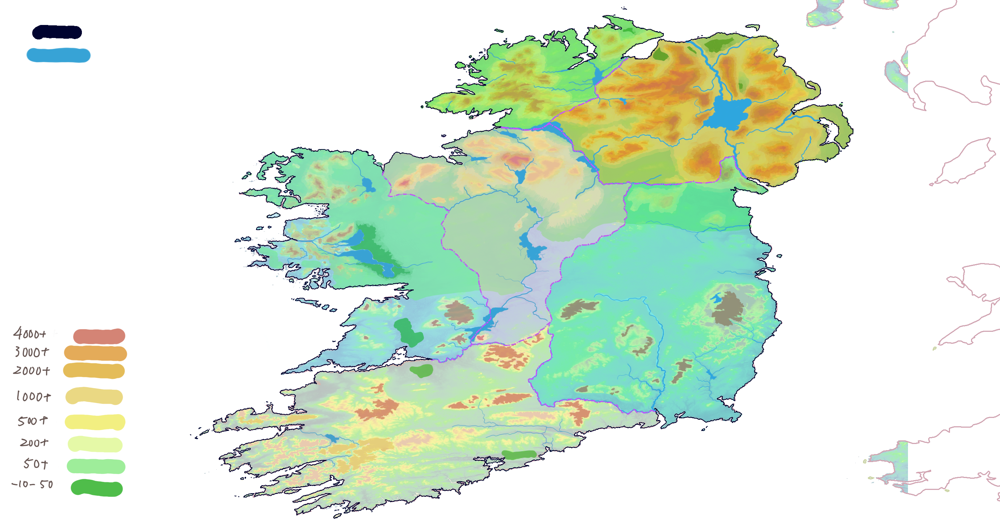

# 年表

| 年份   |                                                   |
| ---- | ------------------------------------------------- |
| 273  | 阿斯克进入本位面                                          |
|      | 绿缚劫持事件，阿斯克取得绿缚派信任                                 |
| 277  | 阿斯克任塔马克冬青大灯塔修缮工程首席设计师                             |
| 287  | 冬青大灯塔第一阶段工程完工，议会决定授予阿斯克“灯塔守卫”一职                   |
| 420？ | 蕈质能退化技术向民用能源领域开放                                  |
| 509  | 阿斯克为瑟夫林绿吟派议员舍夫兰·阿罗伊德之妻提供人偶身体                      |
| 510  | 就诊金与人偶制作费，舍夫兰同意以医疗贷款形式延期支付                        |
| 515  | 舍夫兰公然弹劾阿斯克，激怒绿缚派，引发小规模兵变                          |
|      | 舍夫兰在塔马克社会性死亡，携儿女离开                                |
| 652  | 巴尔契与阿斯克丧女                                         |
| 661  | 卢卡利·兰佩洛奇出生                                        |
| 665  | 内卡苏希姆·兰佩洛奇出生                                      |
| 666  | 塞尔吉乌斯·阿罗伊德出生，都柏林皇帝长子出生                            |
| 669  | 前绿缚学者阿什纳德之子，阿列克斯出生                                |
| 671  | 皇帝对外宣称皇子早夭，阿斯克前去回收龙化皇子                            |
|      | 阿洛伊斯皇后废后风波                                        |
| 673  | 皇后就龙血炉心计划与绿缚·拥夜合作，拟以皇帝基因、皇后基因、鲲血液样本、古蕈龙孢子融合制造人工蕈龙 |
| 674  | 人工蕈龙计划失败，塞瑟拉齐出生                                   |
| 675  | 都柏林皇次子兰斯洛特·金出生                                    |
| 680  | 萨拉丁出生                                             |
| 682  | 马利克出生                                             |
| 684  | 塞瑟拉齐被发现寄住于阿什纳德家中，发现者穆丽塔将此事上报至官方                   |
|      | 阿斯克启用机体赤松，化名居伊斯（Giúis）前往帝国进行调查蕈龙案                 |
| 686  | 米斯戴尔边境矿井爆炸                                        |
| 689  | 安托南于棱镜塔任职                                         |
| 690  | 卢卡利与露西安娜·阿洛伊斯公爵结婚                                 |
| 692  | 马利克与阿洛伊斯家族签约，建立直接雇佣关系                             |
| 693  | 内卡苏希姆代任执剑法师                                       |
| 695  | 塞尔吉乌斯与棱镜塔档案员阿丝塔尔黛·阿宾顿结婚                           |
|      | 马利克开始参与龙血炉心项目的重构                                  |
| 698  | 内卡苏希姆与公务员布里·范迪克结婚                                 |
| 699  | 艾米萨拉·兰佩洛奇出生，同年年底，希尔哈利姆·兰佩洛奇出生                     |
| 701  | 米卡雅·阿宾顿出生                                         |
| 704  | 布里因公殉职                                            |
|      | 阿什纳德在病中饿死                                         |
| 705  | 马利克离开龙血炉心项目，前往塔马克，投入塞瑟拉齐门下                        |
| 707  | 土灵士学派异变，塞瑟拉齐与马利克的学术成果开始被正式认可                      |
| 709  | 内卡苏希姆在对神使作战中牺牲                                    |
|      | 塞尔吉乌斯升为首席农业大臣，兼No.1执行人，艾尔堡领主                      |
|      | 赤松在帝国方面得知神使的最后目击地点为吉尔加拉德火山地区，紧急撤回塔马克防守                 |
|      | 卢卡利以研究为由，借米卡雅的身体令内卡苏希姆短暂回归                        |
| 710  | 马利克出任塔马克牧首                                        |
| 712  | 阿斯克对马利克执行灵魂解离，其后马利克令鲲侵入自身神识                       |
|      | 绿缚·拥夜的激进派被肃清，马利克随鲲沉入海底                            |
|      | 塞瑟拉齐继任牧首                                          |
| 717  | 阿斯克接受塞尔吉乌斯的请求，随塞瑟拉齐的科考团队进入汉诺领，与米卡雅接触              |
|      | 米卡雅得知灵魂寄生事件，与卢卡利对质后跳下倒影山，叛逃至塔马克                   |
| 718  | 吉尔加拉德火山爆发前夕，都柏林接受塔马克的援助                           |
|      | 时任皇帝兰斯洛特试图与塞瑟拉齐认亲                                 |
|      | 年末，塞瑟拉齐跳入火山，取得地脉控制权，成功阻止火山喷发                      |
|      | ？？？被排出并侵入米卡雅                                      |
| 719  | 卢卡利去世                                             |

---
  
# 地图

