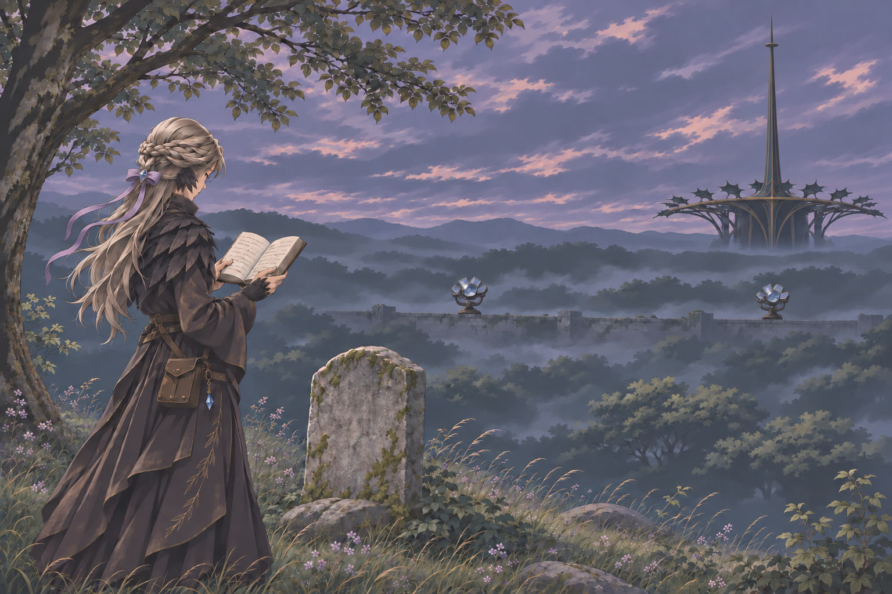

又名《后冬青回忆录》

作者：Acre

鸣谢：04·幻影（维护），Senua（评阅），Claude Opus（校对与翻译），ChatGPT 4o（校对与翻译），Gysgt_Stern（灵感提供）

---
## 章节索引

- [0](#0)
- [1](#1)
- [2](#2)
- [3](#3)
- [4](#4)
- [5](#5)
- [6](#6)
- [7](#7)
- [8](#8)
- [9](#9)
- [A](#a)
- [B](#b)
- [C](#c)
- [D](#d)
- [E](#e)
- [F](#f)
- [Ω](#ω)

---

## ==0==

从精灵老头儿的葬礼上回来时，我买了这个本子，以后写日记就用它了。

——说是这么说，我未必会每天写。我是个懒人，一个有手写文稿癖好的、懒人，逼着这样一位懒人每天产出文字可是件很残忍的事情，更何况制作这种纸质笔记本的工艺十分古老，纸张价格贵得不容许我随便写写画画再撕去几页，如果按照写实验记录那种流水账的文法来使用这个本子，我迟早要为了这个癖好破产。

大概是有所感悟时，我才会拿出这个本子，写上几笔，以文字记录加深我的记忆。日期未必需要写清楚，我只需要知道时间顺序的前后就足够了。

比如今天。这一天，我在这个世界结识到的最投缘的人被烧成了灰。

唉，可惜我与那家伙——那精灵老头儿的关系只能止步于酒肉好朋友，时势与心境锁住了往后的可能性。

这个世界的精灵寿命比起故乡的那些要长上不少。我记得年轻时读的医典上有写过，精灵族，平均寿命估测为一百二十岁，而这位朋友活出了差不多七倍于这寿限的长度。

他的名字叫巴尔契，巴尔契·莱艮德，最初我记住这个拼写的地方是办公室门上挂着的名牌。他劝我给自己的“办公室”也挂个牌子，这样方便别人认门。我那时反问他一句，你觉得我该怎么自称呢？我作为一个从其他世界不慎掉入此间的外乡人，拥有的名字不再是地位、权力与人情的钥匙，字母组合间暗含的寓意在这里无人能理解，它仅仅可作为代称，后续还需要以我的言行与交际为名字赋予价值。我或许讨厌我的旧名，或许对它并无特殊感情，也可能，其实我深爱着我的旧名，当我心血来潮为自己起了新名字、让别人用另一种方式称呼我、我感到异样时，我才知道我多怀念过去。老东西，你应该也有过这种心血来潮吧？你的情况其实类似，你的生命跨度足够长，长到你可以自然地消失一段时间再出现，偷偷地为自己冠上另一个名字，假装自己开始了新的人生——巴尔契·莱艮德，这是你的本名吗？

“我的名巴尔弗雷契(Balfreki)，图书馆地下二层C区战争博物馆316号藏品巴尔契之弓为证据；我的姓莱艮德(Rengend)，用精灵语写就的初版灯塔建筑设计文稿中便有记载，圣不仁以万物为刍狗，匠(Cræfitga)并猎(Rengen)走，而筑塔。”

当时巴尔契扯了张软凳坐在我办公室的门口，看我收拾各种新搬进来的瓶瓶罐罐。室内的窗全开到最大，塔马克林地的风带着微淡的蕈类迷幻香气往屋子里灌，巴尔契那头半散的黑卷发被吹得乱飞，显不出年龄的脸上是种恬淡的神情——他的胡须修得极干净整洁，脸部脂肪不多，皱纹更少，眸子如星般地亮，细长有力的腿像不拘小节的年轻人那样交叠跷着，预备给我挂到门口的石板则被他用手压在腿上。

巴尔契实际上是个长得很好的男人。那时我后知后觉地停了手上的收拾，不小心陷进了他那双眼睛里，直到回神后才吐出个简短的词。

“阿斯克（Askr）。”

“嗯？我没有其他要问（ask）你的。”巴尔契眉毛微微一挑，他吐字清晰，发音规则完全遵循塔马克本地语言习惯。

“听清楚了，是Askʀ，Askrpir，或者Ασκρέπιος。”我这一遍有意将简称的颚音加得极重。

巴尔契的眼睛明显睁大了一些，他重新将我从上到下打量了一遍，普通人类女性的脸，颊侧和颈部爬上的黑鳞，身后细瘦的爬行类尾，以及我那标志性的、脑袋两侧取代人类耳朵的弯曲双角。

“你这长相再顶着这么个名字，可太符合阿兰斯特人对龙族的刻板印象了。我的朋友阿斯克，这种发音方式只有少数龙和古精灵会用。”

但这一回，他的念法就非常精准了，轻重音适当——他刚才也说了，龙与古精灵，他是后者硕果仅存的一位。

我看他动手往石板上刻字，只轻飘飘回了他一句“我又不是真龙裔”，接着去排我的炼金药剂。

阿兰斯特这个岛屿的语言与我故乡的通用语基底相似，词语发展趋势略微不同，我本以为在这边的语言学习课程能一眼看到尽头，那老头儿却一边低头刻着字，一边以那种“亲切”的语言唱起了小调。

他唱得太专注，以至于我不忍心打断他说，我听得懂歌词，这是纺织女工的自述。

也是到后来我才知道，那首歌是他为妻子写的。古精灵族群因战争而消亡，战争爆发之前，他只是个普通猎户，家里有位善织布的妻子，有个喜欢养小鸟的儿子。

在那之前，我只知道，我这塞了满脑子危险思想的家伙出不了塔马克，巴尔契派给我的灯塔看守职位实在再适合不过了。

巴尔契送的门牌上只刻了四个字母，后来的人们空口读的是“提问”。他没自作主张为我加什么姓氏，推脱的理由是“我觉得你的姓氏出自一种我不懂的语言，不会写，不写了。”

我最初对他以姓自称，Ōbaku-in，搬办公室那天不知道为什么突然破功将真名告诉了他。那时我接过他的石板，又掏出自己的工具，在牌子的左上角刻了三个字，满意地看他眯着眼，真正地像老头儿那样去看那三个符文一样复杂的方块。

真是信了他的邪，这老头儿的遗书里指名我为新一任灯塔的最高管理者，不过他写的是，黄檗院。

他遗书里的方块字画得矮，散，使蛮力，和我当初学写这种字时写得一样丑。

…他是个看透世事的老东西，我是个极度无所谓自己的烂人。

我承认我很早就对巴尔契起了色心。我在他的那双眼睛里看到了太多故人，又在图书馆里查到过巴尔契其人在塔马克建立后再婚数次的文书，我邀请他陪我在郊外喝酒，微酸的酒能够掩盖住杯中催眠药剂的涩味。

但也就是这双眼睛的主人摩挲着酒杯，问我，黄檗院是什么意思，我不想对着这样的眼睛说谎，我如实答他，黄檗是我故去丈夫的法号，本意是种防经书腐坏的药物名。那人生前是位宗教人士，他的姓氏会随法号变化，并继承给后代，也就是黄檗院。他救我于微末，我会一直记得他。

随后我从巴尔契手中抽出了酒，连同我自己的那杯，一同倒到土地上去。

敬故人。那时我这样补充说。

敬故人，今天我想如此写。

## ==1==

我最初来到这里时，具体的位置并不属于塔马克。那是个满地玻璃屋顶房子、人类苍白病态地维持表面风度的城邦。麻烦来得比我想象中快很多，我刚走进一家像是食品店的屋子，那店老板就以一种极为强硬的态度要我脱下兜帽。而当我露出爬行动物一般的头部与覆满鳞片的双手后，周围的人纷纷惊叫，有些惊惶地逃出店门，有的保持面朝我的姿态往后退出几步，我甚至能从周围的以太场的流动状态中感受到他们在准备高伤害性法术。

——这也就是我选用探测性能最优秀的活体人偶进行位面跨越实验的理由。我依旧能够感受到以太场，刻文机关仍在正常运作。逃有逃的思路，打有打的储备，我并不准备选择看上去比较有趣的后者，而前者的实际过程只需要一眨眼，我更好奇他们为何如此如临大敌。手在斗篷下面捏出了几枚静滞与内爆刻文，还在我视线内的人群只是在紧张地进行法术准备，他们没有直接进攻意图，我猜是在等什么更强大的人前来，或者仅仅是在等我率先发难。

我干脆解下斗篷丢在旁边的座椅上——宽大的斗篷将我手上的动作挡得严严实实，而此刻我随意地将身体倚在柜台处，双手叠去脑后，忽略掉以太场中奔涌的能量与信息流，我等待他们给我进一步的反馈。

他们使用的语言我基本能够听得懂。于低声交流中，他们称呼我为“非人生物”或“龙裔”。

非人，实至名归；生物？可真就未必。

“嘿！各位，你们和上头传讯的时候，记得加一个短句，位面跨越实验事故。能听懂我说的话吧？”

在向那群紧张兮兮的人们喊出去这段话后，我明确看到了部分人脸上露出了诧异的神情。

我是希望能够表现出我的无敌意倾向的，脱下斗篷显示我并未佩戴武器、露出双手并保持手部不自由状态，避免使用冲突性词语进行交流。结果是毫无意义，对峙了大概十分钟后，一个衣着考究的老头儿赶到现场，啊…在那之后，我兴致全无。

我自认为我是个老人，因为我的过往经历足够撑起普通人的寿限，同时我也可以自认为我是年轻人，我对于不同于自己认知的观念不会像老家伙那样立即表示抗拒。试图理解、分析、从中明确我的倾向与观点后尝试进一步交流，这是我一贯的作风。

我试着问那个人。你们称呼我非人生物，并非“他”或“她”而是“它”，难道在这里，我看起来不是人类？

但他谈话的开头就是扣帽子——“你拥有并非人类的外貌，这足够将你定性为我等之敌。”——没有听人把话说完的习惯——“我劝你少吠叫两句，你试图攀扯我等的行为只会令你罪加一等。”

“罪，好的，罪。请您稍开金口，告诉我这个不懂规矩的外乡人，我的罪名是？”

看起来像是德高望重老领导的人只回我一句擤出来的冷哼，与他手上的剑、汹涌的魔力流。

理解阿兰斯特人思维逻辑最难的一个环节便是此处：负罪，这在阿兰斯特是个很轻易的事情，此后的年岁里我对此事实有越来越清晰的认知，可当时的我无法理解“非人生物拥有智慧即为罪孽”的实际意义。

逃有逃的思路，在那个老东西的面前，我的人偶身躯霍然倒下，灵魂攀上传送刻文回到故乡亲切的小塔楼，随后我迅速钻入战斗性能最为优秀的躯壳之中。以旧人偶身躯为锚点，接下来只需要施展普通的传送法术就能回到那个位面，我确实想要试试老头儿大人的剑技或者法术，如果它们锐利到能够撕裂我的灵魂，我可能会狂喜至颤抖。

哈哈，可如今我坐在塔马克，手写以上的笔记内容。实际上我没能和那些人打得起来。跨越位面的传送法术会有一定的时空偏移，我再回去的时候掉在一片树丛里，旁边是那群人举行焚烧我旧人偶身体的仪式。

我很清楚我自己的外乡人身份，作为本地人生活中的异物，最礼貌的做法就是将自己透明化、假装自己是一丝空气，静悄悄地经过这些人的日常生活。战斗？开玩笑的，开玩笑。我弯低了腰，无声息地离开了这个城邦。

巴尔契出于好奇心问过我，为什么最初会选择那种蜥蜴一样外观的人偶进行实验？我把环境以太感知的概念稍微拆开了点来解释给他听，简单来说，如果想要提高人偶的以太场感知灵敏度与探测精度，最简单的方式是将一部分刻文做在人偶表面，这呈现出来的效果和爬行类动物鳞片十分相似，再按照我那边存在的蜥蜴人类样貌染染色、加点修饰性的鳞片，就是烧毁在汉诺的柚型扩展机关人偶了——我真没想到，这个世界的人对于异类样貌的敌意如此之强。

塔马克人认识的我近似于“龙化特征明显的混血人类”，其为柏制刑罚人偶，各方面条件均是顶级，法术性能优秀。我循着水路行进，深入林地，途中遇上防御性法术就将其暂时静滞化，猛兽或毒蕈则一一避开，如此我直直撞进了塔马克的领域，巴尔契与当时的牧首涅菲尼就等在城市的关隘口处。

涅菲尼，你觉得迎面向我们走来的，是客人还是敌人？巴尔契低声问，他的声音在空气中扩散，微小的一缕溜进我的耳朵，我便听到了。

“保证是客人的！包的！”我在他们能看清我的脸与双手的距离上停下脚步，并举起双手，向他们喊出这句话。

不管是客人还是敌人，我们都可以先和他谈谈，毕竟他是个有理智、可以交流的对象，且我看他的意愿也是这样。我是只善良怯懦的羊，在安宁的生活中生存了很久，我闻得出狼与牧羊犬的区别，站在我们面前的是头莽撞的牧羊犬。涅菲尼作为正式的被提问者，如是回答。

“嘿！我可都听到了喔！你们说我是牧羊犬！”

我向他们挥舞着双手，“谢谢你们夸奖我！我喜欢狗，尤其是牧羊或驯鸟的犬种！”

啊…我明白你的意思了。巴尔契深深地看了我一眼，拍下涅菲尼的肩膀，再挥手示意关隘口的警卫停止施法准备，随后一抖外套，转身入城。

我听得到他们的言语，我听得懂他们的口吻。汉诺人的窃窃私语，塔马克人的嗤笑，威胁的话，怀疑的话，诘问，迷惑。但当肉体无法触及死亡，精神又坚韧如钢时，一切非难就都在我可以承受的范围内了。

啊哈，汉诺并没有损失什么，塔马克也没有得到什么。我并不是什么能够影响世界格局的大人物。在那之后涅菲尼和巴尔契就知道了，我只是个对什么都无所谓的古怪外乡人。

## ==2==

塔马克人花了一星期完全确定我的世外来者身份——又或者确定了我是个有才能的臆想症患者，我的技艺无人认得，我的自述与当前的世界格格不入，但我的施法手段基底与他们这群人相似，使用的语言又有一定程度的类同。

牧首涅菲尼与我进行了多次交流，两个人都老老实实坐在诚实之域内谈心的那种。

——您为什么选择来到这里？

实际上不是我选的。这是我第一次对自己施放位面跨越法术，连自己都不知道会被丢到什么地方，只能说按照我那边的传送理论，我多半是随机传到了“与我有关联的”坐标附近。

——能详细说说这个关联吗？

我目前只有几个猜测，接下来一个一个说，你可以随时打断我进行补充提问。

第一种可能性：我的故乡存在一种说法，现存人类的灵魂并不完整，而是碎片化的状态，本属于一个个体的灵魂如今碎裂并散逸于多个平行世界，或许这里是平行于我故乡的地方，与我相关联的碎片正处于这座岛屿的某个角落里，于是我突兀地掉落至此处。这个猜想可以顺便解释两地语言相同的现象，但我的情况比较特殊，所以我自行推测了第二种可能。

第二种可能性：横向对比故乡的人类，我的灵魂性质极其稳定。即使粗暴地将灵魂以太作为单纯的能量使用，其中的信息也难以逸散。它们多半会重新在某个合适的物体中富集，等待能量注入、自行合并回灵魂主体。

——您的这种特别之处，是偶然的天赋，还是…？

嗯…以我的经验来看，这不像是真正偶然生发的天分，此特质也绝非我后天训练的结果。我的母系家族曾攀附龙类，往最坏的情况去想，甚至可能曾与龙类媾和。据说母亲是逃出、或被救出、被劫持出，总之是脱离家族后生下了我，不过嘛，我更多遗传到的是母亲的样貌，与父亲、甚至是与大概欺辱过母亲的伯父相比较，我们的相同特征非常少，如果再悲观点说，我与他们可能只有种族和性别是一样的。

——等等，您是说，您是男性？啊…也对，您现在是人偶之躯。

我以男人的身份、以女人的身份均生活过数十年，你可以随意认定我的性别，我自己是不在乎这些的。我当下选择使用这个女性身躯，只是因为它是我的最得意之作。

回到原本的话题。很久以前我就作出过假设：或许我不幸遗传到了龙类的部分特征，也或许我的出生本就是人龙禁忌试验的结果，总之这种“黏性”极强的灵魂性质是与龙族类似的。你没有对“龙类”概念发起提问，在我说出人龙结合时也没有露出太诧异的表情，那就说明这个岛屿上存在龙，且人类与龙的关系不算太差，你们对于龙类的了解有多少呢？或者可以将议题缩小一点，你们有多了解龙类的灵魂？

——别说是龙，目前为止没有什么人研究“灵魂”这个概念。

哎，那你们有对于以太，或者简单点说，对法术能量的进一步研究吗？我认为法术能量具有信息的性质，而灵魂除了具有对记忆等信息的保存能力以外，它本身也是一种惰性的能量体。人与龙的灵魂性质区别有七成是信息的编织形式，二成是能量的变动难易程度，剩下的一成我暂时没有解析完全，这涉及到灵魂的物质化。但是，即使是在当前的技术阶段，我也可以模拟制作出龙类的灵魂素体——不具有记忆信息的灵魂素体，我的人偶就使用了这样的技术。或许，这种模拟出的灵魂与岛屿上的某位龙族过于相似，于是我被牵引至此。不过我没有见到任何龙族、龙裔，或者物质化的灵魂体。

——这个猜想实在过于宏大且大胆了。我想，短时间我应该很难完全消化刚刚的信息，恕我愚笨。

至少你完整听下了我念叨的这些东西。我知道的很多智者都不具有耐心倾听的能力。如果安静听人说完话是笨蛋的专属，那我愿意变成笨蛋、与笨蛋做朋友。

第三个猜想，在我不知情的状态下，“我”曾来过这里。从传送理论上来说，这个猜想的可能性最大，虽说略显荒谬，可如果你们这个世界的龙族也是位面旅行的好手，那或许就有解释了。

这种解释建立在“我出生于禁忌实验”的基础上。人类若想攫取龙族之力，只图一代的做法是直接受血，若为后代着想则为混血。混血是由胚胎自行根据遗传信息构建新龙类躯体、灵魂与力量的过程，受血则是放任龙血携带的信息侵蚀、重塑个体，成为拥有相同灵魂基底的伪子代，甚至可能是同时复刻了龙族记忆与躯壳的衍体；一个是挣扎着产生新个体，一个是安稳地制作副本。或许我是个胚胎阶段就受了血的倒霉蛋，如今追着我的母本来到这里。

——您把这个猜想放到了第三顺位。

嗯。我说过的吧，这个猜想成立的基础是“我的类龙灵魂来自于受血”。受血不是简单地接触或服用龙血，它更接近于龙族以人类最容易接受的血液为媒介、将自身的灵魂切割出去一小片嫁接到人类身上。这一片可以表达为记忆，可以表现为力量，不过最大的可能还是二者混杂，于是受血者常有行为失控、疯癫、暴动的早期表征。龙的力量受限于人类的躯体，无法施展；龙的记忆与人的记忆交战，试图反客为主。受血几年或几十年后，受血者终会长出鳞片、角尾与爪，不得不混迹于龙族群体中生存。你看我有这样的迹象吗？虽说躯体是人偶，但我头脑清明，意识里从未出现过不属于我的异物，若我是受血而来，那只可能是赐血的龙族异常强大，能够分离出纯净的素体。

你的表情不对。你们这里有类似的案例？

——南边有个著名的混血龙裔家族，可按照他们的家族发迹史与您的描述来看，他们先祖获得的龙血祝福更接近您所说的“受血”，且那先祖是个有名的智者，度过了非常平静的晚年。

……唉，如果我真的是什么受血者，我可真的会难过。受血者身份不会动摇我对自己的认知，但会证实我的确是个只有母亲的野孩子。

我幼年时，家乡曾遭瘟疫，其时母亲与刚出生的弟弟不幸染病，于是父亲将我卖给了伯父，价钱和好年头里的耕牛差不多。我当然恨过父亲，但我也知道，他会拿着那笔钱去皇城里请医生为母亲和弟弟治病，在爱着两位至亲这一节上我与他没有什么不同。年龄越是大，越怀疑自己的血脉传承，对他的诃责念头也逐渐淡了，但在内心深处，我仍希望他能重视我一点。

——我想到了一个有趣的可能性：如果当初有决定权的人是您自己而不是令尊，您会将自己卖给伯父吗？

我很难确定那个时间点上的我会怎么作决定，那时候我还是个心智不成熟的八岁小屁孩，但如果你肯把年龄限制放宽到十岁甚至十二岁，我不仅会卖，而且会向伯父讨价还价到三倍于原先的价钱，多长的那两三岁足够让我看得出来伯父到底有多能赚。真别把我当成什么高尚得不得了的人。

——朋友，会选择卖出自己这件事本身就足够证明您的美德。这个世界，或者说这座岛上的大部分人更尊崇“自我”的概念，利他是种稀有的观念，一种…理想主义。

那我这个外来人可真长见识了。我觉得爱护子女、亲慕兄弟以及敬重父母是种义务，如果仅仅做到这些就“值得嘉奖”、“彰显美德”，那“家”与冬凉夏暖的合租房屋没什么分别。

——您说得有道理。我受益匪浅。

涅菲尼·阿洛伊斯。在谈话中提及的龙血家族就是她的本家，那是个盘踞于岛屿南部的贵族，拥有世袭爵位，为瑟夫林领大领主。不同于这个家族在血脉中传承的雷厉风行个性，她是个温和的、迷茫的废品。以她的才能足够在普通人中鹤立鸡群，但鹤之上还有一群毛色鲜亮的火凤凰。在这个家族中，软弱是无异于愚蠢的罪行，没有人直接用言语征讨她，可“质问”本就不限于言语，可以是冷落，视而不见，随意支配。她认下了这项罪行，于是在成年当天，她割下了自己的一头红发，挖出眼球、细细擦拭，将它们摊在梳妆台上，阿洛伊斯家族赖以自豪的火亮虹膜如宝石般闪闪发光。

这后面的故事是我给涅菲尼调制染发剂时问出来的。出于礼貌，我问她，要不我给你做个人偶？至少不用经常补染头发，省去很多事。她则只是笑笑，没说答应的话。

## ==3==

Il était un petit port,

Où les gens venaient de partout,

Une fleuriste courait dans les ruelles,

Les pêcheurs rentrés séchaient leurs filets,

Il était un petit port.

「从前有个小海港，

四方的人们在码头来往，

卖花的姑娘跑着穿过街巷，

归来的渔夫坐在门前晒网，

从前有个小海港。」

Hors du port, un vaisseau fantôme,

La pluie et le brouillard voilent ses voiles,

Certains guettent son retour à l’horizon,

D’autres gardent le port, barrent son chemin,

Hors du port, un vaisseau fantôme.

「港外有艘幽灵船，

海上的雨和雾遮着船帆，

盼它的在码头朝地平线看，

怕它的守着港不让它靠岸，

港外有艘幽灵船。」

La capitaine était étrangère,

Elle savait le seigneur cruel,

Ses canons réduisirent le palais en poussière,

Mais les ruelles et le port disparurent aussi,

La capitaine, cette étrangère !

「船长是个异乡人，

她早知道领主麻木不仁，

大炮将领主宫殿轰成石粉，

可那街巷与港口也不复存，

船长这个异乡人！」

## ==4==

我向塔马克图书馆提问：岛上有龙吗？

三天后，图书馆给我的回答是个没带时间限制的“有”，过去，现在，未来，“存在”。

我向塔马克图书馆提问：除了馆长巴尔契，这岛上还有其他见证了全阿兰斯特纪年的老东西吗？

十天后，图书馆给我的回答是个有时间与空间限制的“有”：塔马克的三条龙，过去，过去，现在；海渊上，山脉底，灯塔中，“并非见证，仅仅存在”。

我向塔马克图书馆提问：不是，兄弟，塔马克冬青大灯塔（Ilex）是我造的，我怎么不知道灯塔里头住了条龙呢？

三小时后，图书馆给我的回答是个非常浪漫的故事：工匠精灵于偶然间发现了一颗能够发出星辰般光芒的奇异宝石，他们耗费巨量的人力物力，以此石为神明打造了精巧绝伦的宝石头冠，可神明见惯了星光，对这仿造的星星不屑一顾，谈笑间随手将头冠丢进了火山。先不论工匠精灵因此发生的暴动，其时一条地龙在火山的岩浆中找到了未完全焚毁的头冠，高兴地把它戴到了头上，它惊异于星辰宝石为它增添的美貌与力量，顶着它在地底世界各处巡游。地底的生物们高呼着，泥土之上的神明另有其人，而您是泥土之下唯一的神明——地龙在这类褒美之词中迷了心智，它想，神明有升往天空的止境城居住，那它作为地底之神也该有通向地心的广阔寝宫，一想到这里，地龙也没注意自己正戴着冠，选定了一片神与精灵都不愿涉足的孤立地，埋头便向下钻挖。可怜的地龙不知道，“地上的”神明对工匠精灵们的反逆行为十分不满，令神使押送工匠们去流放，而工匠的好朋友猎手精灵悄悄追上他们，两方呼应，于不知名处合力将神使诛杀，用神使的血晶作宝石，重铸了更加精巧的头冠。得知神使暴毙、头冠再铸，神明大为光火，于是祂们启动数百年间仅释放过一次的大魔法，以头冠上的星辰宝石为目标，自天穹降下巨大的光锥，欲将这群叛贼烧成灰烬。只不过，神明不知道再铸头冠用的石头和星辰宝石毫无关系，祂们的惯常思维里，工匠们为自己养护饰品、修复宝石，最后呈上的总是与从前完全相同的美妙艺术品，可实际上那光锥直直瞄准了正在挖掘地宫的地龙，神谕推动锥体一层层凿开泥土，还没等地龙反应过来是什么东西在它头顶隆隆作响，光锥便贯穿了它的头部，星辰石头冠也被光锥碾成星尘。藏匿起来的工匠与猎手们看到光锥破开天穹、落至远方，无处可去的他们追着这道光，发现了被凿开的地宫，以及地宫底部龙类的残躯。他们修整了这处，用地龙那沾着宝石粉尘的鳞与骨填补光锥凿出的中轴空洞，如此地宫的每一处都有星光照耀，这便是旧塔马克先民与金冬青前身的故事。传说地龙的精魂仍附在金冬青上，守望着自己的宏伟宫殿与依附于它的地底生灵，因此，“塔中有龙”。

我对着跟图书馆问来的——借来的《塔马克建城谭》愣了半天，狐疑、不解与好奇等心理在我脑中做了好一番斗争，为了让这些念头能够决出个最终胜负，我决定继续看下去。

冬青大灯塔（Ilex），俗称金冬青。塔身细长，外壁呈暗金色，向外延伸出十八“根系”与十二“叶冠”，以此织就塔马克的供能与照明网络。塔马克城地下六转，地上三层，灯塔则远不止这上下加起来的九层高度，塔底深入至不建议开发使用的十二转区域，而若身处塔顶，则可俯瞰整片塔马克林地，极目远眺，其他各领的大型地标也尽可收入眼底。林地以外的人们能看到的，则是散发黄金辉光的“树冠”，以及在那之上直入云端的细塔身。支持地龙附魂传说的证据之一，就是树冠之上的塔顶曾发射出极其强大的能量束，并且轰击中了林地外缘的米斯代尔流寇团据点——一个由各类反社会人格法师组成的极端组织，在首领被能量束轰杀之前，此组织的恶行包括并不限于蹲守在塔马克林地外、无差别攻击进出林地的各类人士。

…呃，这也算证据？我的后背开始冒汗。这事我记得挺清楚，那次是我陪巴尔契去祭扫妻儿的坟墓，回城路上碰到这群混混。他们知道穿黑袍的高个子尖耳朵是不好惹的塔马克老怪物，于是就对着旁边女性身形且有尾巴的我大放厥词，甚至有起哄“老妖怪带着蜥蜴小情人来看死挺的老婆啦”的傻子。巴尔契当时有些想要发作，他低低地用古精灵语骂了一句“没教养的混球”，刚抬手准备施法，我突然向他拦腰一抱，同时脚上发力奔跑，对，我直接把他挂在肩膀上一路跑回了城。回去的路上我一边跟他道歉，一边保证我会给这群人教训。于是当晚我上了塔顶，设置法术增强刻文，将人偶的远距离视觉精度调整至最高，观察那群人的动向，确认了白天里对我嘴巴最不干净的那个就是小头头后，我从塔顶对着他的位置射了发大律令术。所谓的“能量束”应该就是指的这个，律令命中的时候，在当地产生的能量压炸飞了他们不少人和帐篷，而被我选中的目标…呃，他和他附近的人都化成漫天的血沫，它们平等地落到了其他幸存团员的头顶，骇得他们吱哇乱叫。

算了，再看看。

自初代牧首提洛萨建立新塔马克开始，作为城市中轴的金冬青就一直在进行翻修与改造。从最初的龙鳞龙骨架构，到现在的硅晶、黏土、金属与高级纺织材料共同搭造，金冬青的外观已经发生了巨大的变化。（这块描述有一半真。我刚接手灯塔建造的时候，这塔的确灰不溜秋，但地表部分支出去的鳞状物是绿缚学者主张使用的集能装置，地下的鳞和骨则是他们加的私货，那配色都是按他们的蕈龙来的，灰里带点绿，绿中混了黄，黄上透着黑。）

支持地龙附魂传说的第二个证据就是金冬青的建筑设计师，名为阿斯克的神秘龙裔。（谁？我？）此人居住于灯塔，极少在外露面，自从他的名字出现在建筑设计师名单以来，金冬青的外观与技术水准都有了质的飞升。（我觉得是灯塔原本就丑得令人发指，后面随便怎么改都比原本的好看…）另外，此人研发的蕈类质能可控转换技术极大推进了塔马克的科技发展，这项技术也应用到了金冬青之上：从最初龙鳞的星辰微光，到如今可以模拟太阳光强又不会额外产生过多热量的“冬青叶”，这位神秘的龙裔无愧于“现代金冬青之父”的称谓。（他妈的质能转换刻文系统是我提的没错，但我也说了这种技术我只授权给灯塔使用。这书里说得像是蘑菇发电已经飞入寻常百姓家一样，老子自己都快信了。）有趣的是，记录中这位龙裔拥有女性的外貌，却同时有非常男性化的思维与行事风格，且酷爱各类宝石饰品。（有没有可能，我随便掏一枚宝石戒指都能顺手给你炸个大律令出来？）鉴于龙类具有退行发育、茧化重生的特性，以及阿斯克那即使对于龙裔来说也长得过头的几百年寿命，我们完全可以推测，这位阿斯克实际上就是那条死于神诫光锥之地龙的重生体。

……

巴尔契是怎么让这种书出版的？我记得他可没有让虚构史学大摇大摆躺上塔马克图书馆书架的癖好，以他的风格而论，要么这构史里掺了份量不小的真货，要么写这构史的人跟他上过床。

我倒希望真相是后者。那天杀的绿缚学派尊我为领袖，总不能真是因为这种扯淡的理由吧？

## ==5==

总在调查龙类的理由很简单。这个岛上的人类早被我研究过了，排除掉社会因素——我也不研究社会性——这里人类的构造和故乡的没有本质区别。塔马克是个非常优秀的样本取材地，四方的人们都在此来往，军事区的叛逃者，贫民领的流浪汉，皇帝的私生子，爵爷的家养奴，教会的实验品，“似人”，“非人”，我可以不出林地就研究齐这个岛屿上所有的人类发展可能性。所以我的工作重心早就移到并非人类的东西上了。鉴于目前我处于一个对人类的定义范围极其狭窄的怪岛上，我要对上面语境里的“人类”做出解释：我对人类的认知与岛上的任何官方文件说明都不同，我以灵魂素体的构造与性质区分“社会学人类”与“其他生物”。

我自己算其他生物。

距离我来到这个位面已经过去了多久？我无意去计数。只要知道在巴尔契离世后，我才是塔马克最老的老妖精就行，且老妖精记性还算不错，合理利用的话就是一本活史书，金冬青的叶片在塔马克亮了多少年，我就能回忆出多少年。

有些以人类身份生活于塔马克的也能算进其他生物里，其中不乏身居高位者。阿兰斯特历700年前后，这种人格外地多，巴尔契说我该多照顾他们，我表示我作为外来者不该干扰他们的人生。

“早几百年前你这么自称没问题，现在你真不能按外来者算了。你是绿缚学派的精神领袖，设计建造了金冬青，你已经改变了全塔马克人的人生，他们认知中的你是塔马克人阿斯克。”丝毫未显老态的巴尔契窝在我办公室里专门为他设的软沙发里，翘着脚，手上是他最喜欢的小乐弓。“而且我看你之前对马利克很感兴趣。”

“哦！最好还是别提他，我在你面前说他的事可心虚着呢。”我当即放下了手里的修复文稿，双手举过头顶表示投降。

巴尔契的乐弓弹出了一声清脆的“铮”音。“我知道是你给他放了你手下极端激进分子和拥夜者请神活动的消息，我也知道你当时是想利用他见拥夜者的神明。其实就算你不和马利克说，以他的能力也早晚能够查出来。说起来还得感谢你，你在合适的时间催化了事件进程的发展，「鲲」的灵魂与人类同化，最后在海底火山的喷发中丧生，而我们的损失只有一位牧首而已。”

精灵的语调平淡得像是丧失了人性，好像他并不是马利克的老师之一一样。“铮——叮。”

我恨不得把头埋进书堆里，闷闷地回他一句：“对不起……”

“已经比我预想的要好很多了。我曾经设想过塔马克城会因为立场的绝对分歧与这两派发生武装冲突，和自警团提过，也跟你要过武器和城防设计。那群激进分子想抢回蕈龙和地下城的全部归属权，拥夜要的是沿海地区的自治权，这相当于拿着刀站在我家门口，一个说要抓我的妻子割肉烤来吃，一个喊着我的孩子适合剁碎了灌进肠衣晾在他的厨房里烟熏。马利克……他是我养过最忠诚凶狠的猎鹰，戴着你给他打的金爪铁喙，不由分说地将那两人的喉咙撕开了，可惜那两人临死前抓住了他的翅膀，他没能飞回来。”

我至今都能回忆起那场灾难。海啸当天，我传送到了拥夜者集会的据点前，这是传送法术的极限，他们的集会地戒备森严，「鲲」之神威压制了大部分法术的运行，我需要以马利克的名义才能进入他们的会场。马利克先前与我联络说，干完这票他就回塔马克，我需要做的只有堵住他们集会的门口，别让拥夜或者来结盟的绿缚人活着逃出去就可以。这不难，他们的集会地设在海底石窟，我在窟口附近设置好了刻文炸药，这次使用的人偶身体是最基础的育成活体，即使损毁在集会点我也不会肉痛。那时马利克已经引导着拥夜者的神明进入身体，他在祭坛上宣讲神谕，双手在空中随意甩着，如疯癫的戏子，又哭，又笑，嗓音时而宏亮威严，时而软弱无力，狂信徒们手拉着手，低声齐唱的歌谣只有一句词，他被食尽！他被食尽！

“我的意思是说，巴尔契，本来是可以由我来完成这件事的。绿缚那群人既然选择追随我，我就不可能放任他们去做明显没有正向成果的傻事，但偏偏那个时候马利克找上门来。我对马利克感兴趣是……唉，他也刚好是我中意的那类人，聪明，有点小坏，在自己决定好的事情上又出乎意料地固执，可在打算给他送精酿酒的时候，我才突然发现他是和塞瑟拉齐住一块儿的。绿缚曾经对塞瑟拉齐做的腌臜事太多，我本来就不占理，他要插手绿缚和拥夜结盟的事情，我根本劝不了他。”

当时巴尔契看我的眼神有点复杂，我实在不敢确定他目光闪烁的那几秒里，这个老头儿到底想了什么，总之他最后决定把话题转回来，“那你就看在自己这么喜欢马利克的份上，帮帮他的，呃，师妹吧算是？”

我当时的脸色很难看，“巴尔契，别这样消耗我们的感情。”

“你可是我认识的灵魂领域顶尖专家啊，除了你我想不到第二个人能救那姑娘。帮帮可怜的老塞瑟拉齐，帮帮可怜的老巴尔契吧，黄檗院老师——”

“你知道米卡雅和我头一回见面发生了什么事吗？拉齐帮我介绍，我的身体是人造物之类之类，然后这小姑娘捏着嗓子说，啊呀这真是十分罕见(scarce)啊，我当时正眯着眼看她身体里的第二个灵魂呢，随口回了一句嗯嗯你也罕见(recherché)，然后这姑娘就给我甩脸色！这死孩子！傻逼敏感汉诺人！”

巴尔契坐直了身体，不解的眼睛将我上上下下打量了一番，最后停留在我皱成一团的眉心上，突然他眼睛一亮，紧接着嘴唇开始向内缩起，脸涨得通红，这人憋笑一直是这副很辛苦的模样——“喂，怎么了？突然就……”我懒得再去猜他的心理活动，结果他——

“噗、噗哈哈哈哈哈！我的天，阿斯克，你什么时候也开始讲没品的谐音笑话了！哈哈哈、咳咳，哈哈……背叛(treacher)，罕见！哈哈哈哈……”

这死老头笑得直流眼泪，他搁那抓着乐弓狂拍大腿，根本不怕给自己的老胳膊腿和小乐弓撅折了。

“谁跟你似的一上岁数就玩谐音梗？！还有、他妈的别笑死在我办公室里你个臭老头！”

那几瞥下来我就能确定了，小姑娘的灵魂被活生生凿去了一大块，在那空当里填进去的是个糟老头子。鉴于小姑娘的出身，这种事情只会是他们汉诺人自己整出来的，且是瞒着她本人完成。同样的手法我从前对我的仇人用过，那人的后半辈子如同活在梦中，无法感受时间流逝，无法分清幻想与现实；马利克曾逼我对他用过，他让我把他的灵魂剜去大半，靠灵吸髓液吊着命，如此引导鲲的神识侵入，变成了海啸前我见到的疯子。我试过重整他剩下的部分，以素体填补、将其移植至其他生命体重塑、甚至是引入简单思维生物的幼体灵魂进行同化，最后得到的是只比起人类聪明太多，但又坚持认为自己完成了进化的知更鸟。

灵魂具有信息与能量的性质，信息又分为记忆、逻辑与欲望等等，活在梦中的那位的灵魂信息被对半劈开，被我留下的马利克是大部分的欲望与小份记忆，我不知道这位叫米卡雅的姑娘还剩下多少“属于她自己”的部分，她的状态和我见过的最完美灵魂侵蚀案例极度相似。

## ==6==

（这是一张夹在本子中的古旧羊皮纸。鉴于夹放羊皮纸的这一页正反两面均未写字，且笔记本的主人并没有空页记录的习惯，故可假定此页羊皮纸可被视作这本随笔的一部分。）

Morgane,

Si tu trouves cette lettre sur la table d'une maison vide, ou si c'est Keishin qui te la remet, cela signifie que je suis actuellement dans un autre plan, en voyage.

Rassure-toi, au moment où j'écris ces mots, j'ai déjà mené à bien l'expérience de voyage interplanaire, communiqué avec les habitants d'un autre plan, et même trouvé un refuge là-bas. J'ai emmené Ōbaku, Þollr et l'embryon vivant avec moi, tandis qu'Aulne et Giúis sont restés à la maison. Si tu en as besoin, prends Giúis — Aulne n'est pas très stable.

Même si je crois que tu l'as déjà accepté… je pense qu'il est nécessaire de te le répéter : je voyage parce que j'aime une vie libre, pas pour t'éviter spécifiquement.

Quand tu as utilisé le sort de Dissociation de l'Âme sur Yuhashi Yuko, tu m'as demandé quand j'avais réalisé que "tu n'étais pas Maranda". Je n'ai pas été clair à l'époque, répondant vaguement "il y a longtemps". Mais si je te dis que c'est quand mon ex-épouse irascible m'a crevé un œil, tu comprendras peut-être mieux.

En tant que personne formée à la médecine chirurgicale, quand l'éclat de bouclier a transpercé mon globe oculaire, je savais exactement à quoi ressemblerait cet œil pour le reste de ma vie — mais en réalité, il a guéri en une semaine. Cet incident ne m'a laissé qu'une cicatrice sur la joue droite, des questions à méditer, et un panneau indicateur vers une nouvelle vie.

Un sort d'inversion et de stagnation, n'est-ce pas ? Tu as utilisé la magie pour ramener mon œil droit à son état d'avant la blessure, puis son temps s'est figé là. Peut-être as-tu choisi un moment précis, une nuit sans lune ? Depuis, je ne supporte plus la lumière vive — j'ai l'impression que mon globe oculaire se déchire à nouveau.

Quand mon corps originel est mort, le sort s'est dissipé. En préparant mon propre cadavre, j'ai soulevé la paupière : une fente au centre de la pupille me souriait. Quand je pense que tu n'avais pas encore pleinement maîtrisé le corps de Maranda, mais que tu as tout de même risqué ce sort pour moi… j'en suis profondément reconnaissant.

— Mais aussi terrifié.

Je me souviens du cauchemar vécu avec la famille de Maranda. Je me souviens avoir, dans un moment de faiblesse en rêve, invité l'esprit qui avait tué ses parents sans un bruit… et Maranda, qui aurait dû mourir, s'est relevée.

J'ai demandé à cette petite fille si elle voulait rentrer avec moi. Elle a hoché la tête — ce souvenir est gravé en moi, l'un des plus précieux de mon âme.

Je savais que tu étais un archimage capable de renverser un royaume, que tu avais absorbé la vie de mes vieux amis pour survivre. Si j'avais été du genre vindicatif, j'aurais dû te tuer en réalisant que Maranda n'était qu'une coquille pour toi. Mais la réalité ? En me réveillant de ma blessure, avec un œil droit fonctionnel, je suis tombé dans la confusion.

Je t'ai alors confiée à Madame Nijigou pour me soigner, gagner de l'argent, et même faire des folies. Je me demandais si t'avoir ramenée était une erreur. Mais je me suis enivré de ce sentiment d'être "nécessaire". La dette de vie a annulé la vengeance. Tu avais besoin d'un père, moi d'un enfant. Alors je t'ai aimée sincèrement, comme ma fille, mon trésor le plus précieux.

Tes sentiments particuliers, j'ai choisi de faire semblant de ne pas les voir. Je t'aime plus que moi-même, mais ce ne sera jamais qu'un amour paternel. À moins qu'un jour, j'oublie tout par accident — dans ce cas, peut-être serais-je ensorcelé par une existence aussi brillante que la tienne. Mais ma mémoire est hélas trop tenace.

Ne doute jamais de ma perception de toi. Pour moi, tu es Morgane, ni Maranda, ni Morrigan. La jeune Maranda était encore immature. L’invasion de Morrigan, la soumission de Maranda, ton éducation, tes apprentissages autonomes et tes expériences ont forgé une toute nouvelle Morgane — ma fille, dont je suis fier.

Tu es intelligente. J'espère que tu seras plus lucide que je ne l'imagine, que tu te libéreras des liens inutiles pour voler plus haut, devenir, comme tu le dis, la "Reine des Corbeaux". Si je fais partie de ces liens, tu peux m'oublier — c'est une résolution que j'ai prise en tant que père. Mais si tu as besoin de moi, j'attendrai toujours ton message — c'est une responsabilité que je porte en tant que père.

Acrethion

（根据笔迹比对的结果，这一页仍是阿斯克先生手书，但他在这一页使用的可能是他在故乡使用的一种语言，以下翻译内容是在阿斯克先生的同乡帮助下完成的，笔者已尽力追求词语表达准确。）

摩根，如果你是在空荡荡家里的桌子上，或者是从景谌手里拿到这封信，那就说明我当下正在另一个位面，旅行中。

放心吧，在写下这些文字的时候，我已经完成了位面穿越实验、与另一个位面的人交流过，甚至在那里得到了一片容身之所。柏、杉和活体胚胎我带到那边去了，桤、松留在家里。如果你需要，拿松去用，桤的性能并不是特别稳定。

虽然我相信你已经看开了…但我觉得还是有必要再告诉你一次，旅行是因为我喜欢自在的生活，而不是特地要躲着你。

对一桥夕子使用灵魂解离术的时候你问过我，我是什么时候发现“你不是玛兰妲”的？我那个时候没有明说，糊弄了一句“很久以前”，如果我说是从我被暴躁前妻弄瞎一只眼睛时就发现的，你或许会有点头绪吧。作为系统性学习过外科医学的人，在那块盾牌碎片扎进我的眼球时，我就清楚往后余生这只眼睛会变成什么蠢笨样子——但事实是这只眼球在一周以内就差不多长好了，那次事件留给我的只有右脸的一道疤、许多值得深思的问题，以及通往新生活的路标。

逆转、停滞法术，对吧。我的右眼被你用法术推回了受伤前的状态，然后它的时间就停在了那里，或许你选取的停滞具体时间点是一个没有月亮的夜晚，我在那之后再也无法直视强烈的光，那会让我感觉到我的眼球被重新切开、破碎。我原本的身体死亡时，那个法术自然也解除了，为自己收尸时我翻开了眼睑，瞳孔正中开的口子正朝着我笑。想到那时你还没有完全适应玛兰妲的身体，却仍冒着风险为我施术，我实际上是非常感激的。

——但也恐惧。

我记得我与玛兰妲一家人经历的梦魇，我记得我在梦中一时心软，向无声息杀死玛兰妲父母的精魂发出了邀请，然后本该死亡的玛兰妲就这样重新站了起来。我问那个小女孩，愿意和我回家吗，她点点头——这样的回忆烙在我心里，是我最珍贵的灵魂信息之一。虽然我清楚，真正的你是能够颠覆一国命运的高位法师，且为存活而汲取我的老朋友一家人的生命，我若真是什么睚眦必报的血性人，在想明白玛兰妲的壳子里套的是你时，我就该想办法杀掉你，但现实是什么呢…从重伤中醒来后，睁着正常运作的右眼，我陷入了迷茫。那时我将你托付给虹江夫人照看，自己养病、试着挣钱，甚至做过些荒唐事，同时我在思考带你回来是否是个错误。可我又沉迷于“被需要”的感觉，杀人之仇与救命之恩相抵，你需要一个父亲，我需要一个孩子，于是我投入真情，将你视作我的女儿，我最珍视的宝物。

对于你不太一样的感情，我选择装作视而不见。我爱你胜过我自己，但那只会是父女之情，除非我有一天意外忘记了这一切——若真有这种可能，我或许真的会被你这样耀眼的存在迷住吧，可惜我的记性好过头了，嗐。

你无需质疑我对你的认知，我只将你当做摩根，不是玛兰妲，更不是莫瑞甘。幼小的玛兰妲心智尚未成熟，莫瑞甘的侵入、意识对身体的归顺，以及来自书籍、生活与我的后天教导，你的自行学习、见识共同塑造了全新的摩根，也是我引以为傲的女儿摩根。

你是个很聪明的人，我希望你能够比我预想的要更通透些，抛开那些不必要的羁绊，飞得更高，像你说的那样，做“渡鸦的女王”。如果我是那些羁绊之一，你可以忘记我，这是我作为父亲早就有的觉悟。如果你需要我，我随时都在等着你的传讯，这是我作为父亲一直担负的责任。

阿克莱西昂

## ==7==

以我的一家之词而言，牧首马利克——或者说学者马利克的生平最高成就是提出了以太信息频段理论，可控灵魂解离术的成功构建有他一大半功劳。只不过，他应该想不到这项技术会让他变成个新物种吧。

只剩下原始欲望和十六岁前记忆的他，如今是只快活的小鸟。

印象里很少有牧首会跳过“巴尔契介绍”这一步来灯塔里找我，马利克是例外之一，且我觉得他算个极端的例外，这人是从“准备当牧首”时就自己找上了我，头一次敲开我的办公室门时手上捧了瓶酒。灯塔建造者兼守卫在那时并没有实权，我不收学生更不公开发文章，可以直接排除掉马利克来行贿的可能性。

我干脆跟他说，我酒量不好，一杯头疼两杯心悸三杯直接开吐，你办完你想办的事后顺手帮我把这瓶染发剂捎给巴尔契就行。

染发剂？他问。

对，巴尔契说，他最近想把这玩意染成绿的。我指指自己脑袋上的头发，很努力地憋住了笑。

马利克这人的心气在奇怪的地方高得不得了，但对于我这个近乎于“见面报备”的递物请求答应得很爽快。在那之后我们聊了不少关于金冬青能源供应原理的事情，我并不准备藏着掖着，有问必答，不去管他能不能听懂，而他也很聪明地不多过问涉及我的个人技术，提问的重点都在绿缚学者负责的部分上，比如选菌、初期供能，废能二次转化，等等。

我说等等，你问这些的样子不太像个土灵士。

他答，他在进塔马克之前也不是土灵士，而是专门给某个大贵族家里代写论文的枪手，主攻方向是能量理论。

我结合他瑟夫林领的出身一想，脑子里就有了答案。不奇怪，那个“家族”政商通吃，忙于事业而耽误研究，为此请个小代可太正常了。

他又接着解释，十多年前的报告文件里有一些家族与绿缚学派交流的记录，涉及蕈类质能的部分还好，还有些他弄不清楚的育种记录，或许是家族为了自己的项目想要培育更适合需求的菌种吧。

应该是那群人病急乱投医了。我回答道。就我知道的情报来看，你那个家族的龙血炉心用不了绿缚技术，这群人的宝贝蘑菇最怕高温，我做金冬青时为了降低热量产出可是花了快三年测试刻文，换瑟夫林那边的常用技术来的话，那蘑菇一秒就熟，龙血炉心改行做烤蘑菇片零食厂倒是不错。

所以他们在尝试育种，培育有龙类耐高温特性的蕈类。绿缚说，塔马克的冬青大灯塔使用了比较适合蕈类的技术，但他们无法复刻，我以为是您培育出了比较优秀的菌种，但看来您是个纯粹的工匠。马利克说完这些，干笑了两下。

小兄弟，他们如果说的是什么“龙血蕈”，那可就又不是正经蘑菇了。我们假设真能把当初给那家族分血的龙请来割个手腕养蘑菇，这种蘑菇没法完全适应龙血赐福，不会产出具有龙裔特性的后代，对于龙血炉心这种大项目而言，供能蘑菇不能量产绝对是硬伤，但是如果有人舍得出血把蕈人秘密卖给阿洛伊斯，那或许真能成。你在塔马克见过了各种外边不认为算人的存在，但绿缚独有的蕈人你应该没见过吧？那是种有类人智慧、有记忆的可行动植物，龙血传承的硬性要求是“龙类可理解的智慧”，蕈人符合这一点。龙血蕈人…想想就瘆人，不会再畏惧光与热的长寿蕈人，天天被关在炉子里供能，什么时候关出来个蕈兰斯特那可真就乱了套啦。

哦！我一拍脑门，给他多讲了几句。还有种可能，龙血蕈，蕈龙血，血蕈龙，这帮孙子一直想复活他们的蕈龙，之前是想借着重修灯塔干这档子事，被我拦下来了，就又去找阿洛伊斯家是吧？他们真的很喜欢把自己的神塞进发电机？我还记得他们提的方案，选个有罪的女人，令其受孕、给胚胎受血，胎儿成型时杀掉母体，种上蕈人菌孢，再等至足月，剖腹取婴儿，如此得到有龙血保护和蕈人部分特征的类蕈人，再由他们搞套神神叨叨的请神仪式，等孩子靠龙血长大并被龙类性状吞噬，新蕈龙就成了。这个过程光听着就恶心，还好他们没成功过，基本都是折在胚胎受血这块了，他们有的还想让我出面赐血，这种人来一个我揍一个。

……我为什么今天会想起这些呢？从如今的视角来看，这些情报确确实实推着马利克走向了解离自己灵魂的路，他在我施术前向我流泪，说他有罪，他要将自己无罪的部分割离出去，由负罪的部分偿赎罪孽。

可是啊，罪孽到底是什么呢？他认为自己作的恶是“为阿洛伊斯家族出卖头脑”。命运未必由得了自己，君令或不可违，父命或不可逆，人在如此的框架之下行进，可即使处于强权之下、临于霸者之前，人不可不问一己良知，不得推说迫于无奈，不可推说权宜之计，罪推脱不得——即使他并未认出那一方的邪恶，这种不察亦是一种愚蠢之罪。

我认为这种想法十分荒唐，他过于高傲，对过去的自己也毫不留情。他只是为当时的上司谋利，龙血蕈人实验更是发生在他出生之前，何必把这些算到自己头上呢？因为他品行高洁？

“何必呢？”知更鸟——现在叫罗宾——也这么叫唤着。

## ==8==

我今天要讲的，是个瑟夫林人自述的故事。

瑟夫林领的风气相对自由，有些有趣的精灵时代旧民俗得以在此地流传下来，比如故事的主人公自称并没有真正意义上的姓氏，他的名字结构是本名加父名，若是他自己成家立业，父名的部分会摘去，只在填户籍表格时再拿出来用一用。这是种朴实的平民命名规则，说明主人公祖上真是没出过什么有头有脸的人物。

所以当主人公在学校处处拔尖时，还能留在主人公名字里的那个爹可是乐开了花，谁说老鼠儿子会打洞？老鼠儿子出龙凤！作为小匠人的爹拿着儿子挣来的奖学金翻修了家里的铺子，他拍着胸脯向两个儿子保证，爹爹我会一直供你们念书，尤其是老二，这是爹最后一次拿你的钱！作为主人公的老二对此左耳朵进右耳朵出，这个时候他十岁。

十岁，但是被领主亲自接见过，接见的时候…旁边坐着同样十岁的领主侄子，优秀，只比主人公稍差，被领主看重，额外冠了阿洛伊斯的姓氏。

领主问他，孩子，你为什么而读书？

因为缺钱。第一名给的奖学金格外多，所以很抱歉，我得比阿洛伊斯同学的成绩更好。

领主惊讶于主人公的开门见山式谈话，以及小孩子脸上根本不属于他年龄的淡然。孩子，奖学金不止是“金钱”这么简单，它还代表着荣誉，是公众能看到的能力证明。

我明白了，领主大人，阿洛伊斯同学需要这种荣誉，我们家只是缺钱，荣誉不能当饭吃。

…你家到底有多缺钱？领主对着手里主人公的背调资料皱眉。

大人，我妈从前在您开的矿上监工，本来肺就坏了身体也垮，现在矿源彻底枯竭，她被辞退，每个月的下岗补贴全得用来治肺病。我爹只是个小铁匠，挣钱全看运气，有订单就吃得上饱饭，开不了张得喝风。我和我哥还在上学，工坊和店铺都不收童工，所以我们哥俩在学校里卖作业答案，我顺便挣奖学金，这样爹挣不到钱的时候我们也能吃饱。大人，我觉得我家不算非常穷，但是我不喜欢饿着肚子读书，胃里烧得难受，脑袋转不动。

孩子，退休矿工的津贴没那么少，况且你母亲曾经评到过劳动模范，每个月批给她的钱和正常工资不会差太多。

大人，那些都是你们成年人的东西，我是个小孩儿，听不懂也插不进手，我只知道我妈教我荣誉不能当饭吃，以及，我不喜欢每天只吃得到两块手指长的饼干。

领主偏过头，看了看自家那个听得一脸骇然与羞愧样子的侄子，再审视一番面前蜡黄皮的小孩。孩子，如果我要买走你今后的所有荣誉，你想怎么开价？

我们的主人公终于稍微露出了点为难的表情，然后他答，第一，以后我妈的补贴得是大人您的管家来发，第二，我也要每个月领工资，够我们家四口人每天都能吃得上香肠卷饼那种。

领主最终和他签了合同，侄子在学期间的成绩和奖项均由主人公产出，主人公拿三十年的雇佣合同，每个月领他老妈退休前的最高工资，发刊进会的奖金另算。

主人公在十岁就摘了父名，所以我们可以轻松地只叫他马利克了。马利克上工的第一个月就给老板挣了个竞赛奖牌，给侄子写完获奖发言稿之后，他领了管家给的奖金，带着家里剩下的三口人去自助餐厅胡吃海塞，那天光他自己就吃了三只焗龙虾。

妈的，真好吃。这是他对食物的最高评价。

十六岁，领主侄子忙着在大学里拉帮结派培养势力，马利克顶着中学毕业生的身份，一边叼着香肠卷饼一边翻内部技术文件。自从领主这位伯乐让他食饱力足，马利克这匹千里马在学术界跑得那叫一个撒欢，按着领主指示他走了能源动力工程的路数，以阿洛伊斯的名义稳定产出龙血炉心的技术论文。领主并不盲目，她知道这个侄子虽然能力也不差但没到千里马的程度，部分新研究由领主出手压下不发，让侄子去背他能理解的文章参会，另一边则是给马利克的工资提到了技术骨干级别。

填工资单时领主顺便翻了翻马利克存放在领主府里的档案，履历是再平常不过的神童泯然众人矣式，高开低走，中间冒出来个突兀的高智力评定书——没记错的话这个评定结果还被领主本人砍过分数——最后职业一栏填的是铁矿监工，顶了他家老娘的位置。

你说，这么个聪明的人，为什么只图一口吃的就扔掉了所有属于他的名声呢？领主是想不明白的，她差不多也是看着马利克长大，这家伙的野心近乎于零，第一爱钱，第二爱吃，第三爱美，钱是给家人吃，吃饱了去酒吧看美女……嘴巴严实，行事低调，对着塔马克来的访学者装得像个憨人，交女朋友也是浅尝辄止，只有查文献时、看见漂亮女人时和吃大鱼大肉时能看出来他的活人气。领主是想不明白的，不过她也懒得细想，这就像主人不会想问自家的狗为什么吃肉不吃菜。

或者说，领主寄希望于自己的好大侄儿，毕竟一个书呆子能翻出来的水花比起政客可小太多了，而好大侄的聪明就是这种政治家的聪明，让他来处理马利克这个人才合适。

好大侄儿从小就是以家臣之礼与马利克交往的，千里马在这个年轻人眼里是陪读、幕僚，甚至死士——领主放权给大侄子的头一年，马利克翻出来了龙血炉心项目的新能源合作项目旧账，那个方案的效率和他本人改进的差不多，可燃料费是他的七成，于是千里马坐不住了，他说他得去把这个技术授权从当年的绿缚手里追回来。

你去塔马克追？

对，我要追去塔马克。绿缚在那边有人活动，塔马克城也和绿缚有类似的合作历史，我总得从他们嘴里挖出点东西，他妈的生物质能！

行，等你回来了我把用人合同续到六十岁。加油干啊，我的好矿工！

——以上是阿洛伊斯家知道的那个马利克。

聪明人怎么可能没有野心呢？马利克当然有除了食色性以外的欲望，其名为，“认可”。

这个人当然是喜欢赞誉的，为什么他的妈妈会教育他“荣誉不能当饭吃”呢？马利克人生的第一个奖状纸是和母亲的下岗通知书同时来的，小马想跟妈妈要点表扬，结果妈妈失魂落魄，喃喃道，妈妈没心思夸你。

马利克头一次知道自己的老爹不中用到养活不起一家人，头一次知道即使是在阿洛伊斯家族铁桶一般的治理下也有贪腐存在。以及，头一次知道人可以一天只靠吃两根饼干活着，并心甘情愿地产出远超于两根饼干的价值。“认可”是一种高级的精神需求，在关乎生存的物质问题面前，精神需求一文不值。

根据塔马克学者穆丽塔之子阿列克斯回忆，穆丽塔暂住瑟夫林的时候，马利克和他的哥哥萨拉丁几乎天天都要找个由头去蹭饭，作为报酬，兄弟俩承包了这母子俩的一切日常零碎跑腿事务，直到马利克的家门被阿洛伊斯家的人敲开，身着笔挺衣装的管家双手呈上支票，向昔日的劳动模范深深鞠躬。

其实马利克这个人并不挑嘴，在塔马克住的时候能连续几个月吃同样的芝士香肠卷饼。当他用赞誉换取食物并填饱了肚子后，那点压抑在心底的欲望就会破土生长。

最开始，他满足于“领奖金”，然后是“夸阿洛伊斯等于夸我”，再到“我的成绩无人能评”。

他翻着阿兰斯特各界的学术会议记录，记在心里，充作醉酒和约炮的谈资，毕竟凡人喝高了容易说胡话，床上君子的最佳武装之一是吹牛逼，只要前半段吹得够夸张，后半段他说的真心话就不会有人信。

——你这样子倒是和我家老弟挺像的。塔马克的朋友阿列克斯如此评价道。

马利克读着老弟塞瑟拉齐的文章，从他的人生中读着另一个自己，至少马利克自己这么认为。

我们不可能知道他是什么时候真正下定决心不再为阿洛伊斯家族效忠的。或许他从未真正效忠，或许是他的智力评定结果被修改、大学入学申请被打回时，或许是某次酒醉失言时，或许是被龙血炉心的实验记录骇到不住呕吐时，或许是读到塞瑟拉齐的文章时，或许是离开瑟夫林前阿洛伊斯向他提出长年契约时，或许是大侄子夺权失败而被领主雪藏时——或许我只需要说，阿洛伊斯家族曾和绿缚联手，用皇帝的血脉造出了条失败的蕈龙，马利克爱上了这条蕈龙，即你的师父塞瑟拉齐。

或许是爱塞瑟拉齐，或许是爱一个有救的自己，毕竟塞瑟拉齐敢杀了把自己当成实验动物豢养的养父，他马利克没胆量挑战握着父母兄弟命脉的阿洛伊斯家。

他是不是想要通过继任牧首、控制塔马克以拿到和阿洛伊斯谈判的筹码？可他真的那么爱自己的家人吗？那为什么回到瑟夫林领、向领主本人宣示效忠的是萨拉丁，而马利克至死都未再回故乡？

我至今不敢断定，笑着接受绿缚与拥夜顶礼膜拜的马利克是真实的他？抑或在我的解离刻文阵前忏悔自己助纣为虐行为的马利克也是真实的他？也许，当下在这个房间里飞来飞去的笨蛋小鸟才是他？马利克这个名字连带牧首的称号，以及几乎全歼拥夜者的战绩肯定是要在塔马克史书上焊死了，可笑的是如今的拥夜者仍在把他当作神明供奉，如今的你反而不会记得故事里那个阿洛伊斯之侄的名字该怎么拼——或者说，阿洛伊斯真的有这样一位侄子吗？他自己也交待了，只要发言者在谈话的开头铺垫好谎言，在意荒谬之处的听者就会忽略掉其余的真实。

马利克无疑是个满嘴谎言的人，包括这个自述的故事你也得半信半疑地去听，我在他生前与他共事时对这人的工作外发言只信一半，若是没有解离过他的灵魂，我不会对他有如此高的评价，也不会断言他只在谈话的开头撒谎。

灵魂这个东西很复杂，知更鸟罗宾承载的是马利克的原始欲望，这点我敢打包票，但你多半不敢将它与我故事中这个心思别扭的前牧首联系到一起。经历引导逻辑的生成，经历留下难忘的记忆，经历足够扭曲欲望，灵魂的塑造与融合就是这样，它是种需要堆积时间以显现结果的过程。现在在听我故事的人是谁呢？我是否该认为你并非米卡雅，而是新生的前汉诺重臣、内卡苏希姆先生呢？

——如果我真的认为你是后者，又为什么要抱着罗宾，向你讲述真伪难辨的马利克故事呢？

孩子，你只要别再善良地接纳不属于自己的灵魂就好。嘛…不过被扭曲了这么多年，若再有脏东西侵入你的意识，你可未必会像小孩子那样好说话吧。

## ==9==

（这一页并非文字笔记，而是幅炭条画的画。）

（帝国的宫殿顶露台上。老态的皇帝，蛇目的牧首；惊惶的大臣，不安的学徒；覆面的侍从，旁观的人偶；都柏林，塔马克。）

（火山喷发前的预兆烟雾将天边染成了铅灰色。）

（皇帝拉着牧首的手，脸上挤出一副悔恨神情，牧首则微侧了头，视线锁准远方的火山。）

（大臣们从长袍袖子下伸出几根手指密谈，学徒对着手中的晶板咬紧嘴唇。）

（阿斯克先生似乎颇为擅长绘画，虽只有单色的线条，各人神态与动作均格外分明、生动。）

（画作的右下角有一行小字，使用的是阿斯克先生的母语。Jarðar bein，意为“大地之骨”。）

（在这幅画的背面一页，又是母语写成的一首小诗。根据阿斯克先生的母语与古精灵语十分相近这一特点，笔者查阅各类手抄资料，逐句筛查对照，最终做出以下的大概翻译。）

Lát hann fara, lát Askr fara, lát fugl-tamjann fara.

Gef honum lítinn knif, byssu-dryk ok brauð.

Hann mun ekki óttast dreka, þótt þeir biti hann í höfuð eða hjarta.

Lát hann fara, lát Acrethion fara, lát útlendinginn fara.

Gef honum járnsverð, brynju ok skjöld.

Þótt hann deyi í hendr keisara-manna, þá er þat ekki illt.

Lát hana fara, lát Oubakuin fara, lát dauða-andann fara.

Gef henni nafn, leyndarmál ok traust.

Honn veit hvernig hraun kvænist, ok er van að vera blótaðr.

Lát hann fara, lát jarð-dvergr fara, lát svepp-dreki fara.

Gef honum tækifæri, ástæðu eða afsökun.

Hann vill ekki lifa lengr, hann fylgir fyrri mönnum.

让他去，让阿斯克去，让那个驯鸟人去，

给他一把小刀，火药与干粮，

他才不会怕龙族咬走头颅与心脏。

让他去，让阿克莱去，让那个外国佬去，

给他一柄铁剑，盔甲与盾牌，

即使他死在了帝国人手里也不赖。

让她去，让黄檗院去，让那个死魂灵去，

给她一份信任，秘诀与称谓，

她知道岩浆如何平息，也习惯做替死鬼。

让他去，让土灵士去，让那个蕈龙人去，

给他一个机会，理由或借口，

他已无意再苟活于世，他追着前人去了。

## ==A==

巴尔契留给我的是个烂摊子。冬青大灯塔的最高管理者——在作为灯塔基座的地下第七转被重建为新图书馆的当下，接受此职位，就相当于我变成了他的继任者。

伥鬼一样的继任者。我对着时任牧首弥卓发出以上的牢骚。

弥卓是上一任牧首塞瑟拉齐的师侄，身材高大，皮肤略黑，毛发旺盛，据档案显示他喜欢变形为熊。塔内办公室的小沙发容纳不下他的大骨架子，所以多半是我去他的住处找他，今天也是一样，我揣着日常随记用的小本子敲开牧首的门，首先迎接我的是走地鸡们扑闪翅膀的破空声，弥卓爱好养鸡，他的私宅和大型鸡窝几乎没有区别。

伥鬼？弥卓腿上窝着一只白羽小母鸡，低声咕咕叫着，而他挂起一副好奇神情，黑溜溜的眼睛直冲着我。

哦，那是我原本所在位面存在的一种鬼怪。人被山林中的猛兽咬死后，残余的鬼魂会在原地逗留，化作“伥”，引诱路人再被猛兽袭击。

我指指窗外的金冬青，“猛兽。”

我点着弥卓的鼻尖，“路人。”

我将小本子翻在扉页举起，露出画在那里的精灵胸像，“伥鬼。”

“对喔，之后是由您来选牧首了。”大黑熊后知后觉，语气平淡。“也没有其他人比您更合适，毕竟您比巴尔契先生还要不在乎权力与名声，身为绿缚学者心目中的信仰化身又亲近绿吟派，整个塔马克再找不出比您还要公正的人。”

我咧嘴苦笑，弥卓这人把我看得过分高洁了。“我是外来人，这里的权力与名声我带不走，追求这些虚的有什么用？而且…嗐，而且我本人也实在没啥复杂的欲望。绿吟要我的技术和灯塔维护功能，绿缚只是把我错认成了真龙，两边都有求于我，而不是我对他们有所求，我真正肯留在塔马克的原因…和这死挺了的巴尔契有挺大关系，他没了，我想不出继续留在这里的理由。”

“金冬青也不能成为理由吗？这可是您的心血之作。”

“孩子，你看我像那种非常传统的法师吗？这辈子最大的成就就是拥有一座无与伦比的法师塔，每天最值得吹嘘的事情就是在法师塔里读卷宗？我甚至不能算是个法师，我是个手艺人，做出来的东西交付给雇主，是雇主使用它，而不一定非得是我本人。”

我手上握着炭条，在小本子上涂涂抹抹，先前我已经勾勒出了弥卓安静抱着母鸡的坐像，现在是给这幅速写加必要的阴影。至少巴尔契在死前留给我的这个牧首不是什么蠢的，在事业的开头我可以安心看他把持大权，自己接着做那个闲散人，窝在灯塔里提炼精油，换其他人偶躯体出去散心，偶尔遇到有趣的人或事就画下来。

很简单的道理，当你一个人便能完成所谓群策群力才能做到的事情时，当你想要脱身就脱身、想要停留就停留时，权力在你身上就是个虚无缥缈的标签。所以我制作、使用人偶，突破原本肉体的极限，令我始终保持自由。

当然，并不是所有人都赞同我的理论，对此我表示十分的理解与遗憾。

……每个能被我画进手记本的人，都会在他生命中的某个时刻被我如此提问：“要我给你做个人偶吗？”有的人同意，有的人拒绝；同意的人不过是能将寿命延长到他灵魂彻底燃尽的一刻，拒绝者则如常人般幸福地死去。

嗯，早在来塔马克以前就知道，我的法术、技艺与思维并不完全适合狭义上的“人类”。刻文需要灌注自身的生命之力以封存法术，人偶的潮汐能源系统会缓慢地燃烧灵魂，我毫无进取之心，毕生所学皆为满足我的贪欲——将我的珍视之物留存于世上，有如守高塔的恶龙。

恶龙几天前去看望躺在床上的伥鬼——他那时的确瘦得像鬼，皮肤皱缩堆叠，眼球近乎透明，平时精心修剪的胡须成了稀稀落落的乱草丛。恶龙见惯了将死之人，恶龙看着伥鬼那平日难见的老态就知道，这老东西也快到时候了。

“要我给你做个人偶吗？和你之前长得一样的那种，吃喝拉撒睡样样不耽误，我还可以给你的头发染成鲜绿色，独家调配秘方，保证不和任何人撞色。”

伥鬼干瘪的嘴唇抖了抖，他非常用力地盯上恶龙的眼睛。

“好吧我承认，我没有领导者的才能，接不动你的班，我或许会毁了塔马克。”恶龙移开脑袋，嘀嘀咕咕。

伥鬼声音嘶哑。“那就……试试看，毁给我看，向我证明，阿斯克的造物能够打败巴尔契的作品。”

——弥卓，过几天让我去一趟汉诺吧。见几个人，算算旧账。按一般程序走就行。

——您要和谁见面？

——汉诺现在正经管事的人，以及农业大臣。放心吧，我不会要求会见米卡雅，和那姑娘相关的事算正规外交事件了，应该让真正的牧首来操作。我？我就是个没啥政治细胞的傻子。

## ==B==

“既然你这么需要额外的时间，那让我给你做个人偶吧，代价嘛……你的灵魂会用于为人偶提供额外的维生能源，如果你相信轮回转世这类理论，那么选择燃烧灵魂就相当于失去入冥府、转世再为人的机会。你要试试吗？”

差不多忘记了我何时发出了这样的问句，但被提问者的样貌信息仍停留在我的双手之上，因为她接受了我的邀请。我花费三个月时间为她制作全新的身躯，赶在这位可怜的学者被疾病蚕食前背着人偶棺去往她家中——这位是个颇有才能的经济作物育种学者，不过从小就生了怪病，医生预测她的寿限不会超过四十岁，终结是个在新种培育日历上都能看到的近未来事件。

以理论计算，她的灵魂足够支撑人偶燃烧三十年上下，最后她会像普通人一样衰老、死亡，但实际上这人仅坚持了六年——

我不会拦着你寻死，夫人，我对你做的事情本就是逆天而行，选择活与死是你的自由，别人干涉不得，但我想听听你的理由，是身体有不适感？

阿斯克老师，我的丈夫发现我不会死。

这不是自然的吗？你的病被治好后，之前诊断的预测寿命当然不算数。

老师，他在我常吃的杏仁曲奇里下了毒。

……杏仁。

嗯。果然，老师能明白这是什么意思。我那天回家后，他破天荒地把甜品盘子端去我书桌上，我本来还想着他什么时候变得这么体贴，一边吃曲奇一边看抄录下来的实验数据。我眼看着那些数字在我的脑子里扭成了蝌蚪，然后天地倒转……那时，我大概是直接摔在地上了吧，身体已经不受我的控制，感官完全停摆，我甚至不知道那时的我是死了还是活着，害怕、疑惑，这些感情逼得我越来越无法维持理智，就这样过去了几个小时，也可能是几天……

氰化物对人偶的效果不佳，炼金血液辅助氰离子排出需要四十到六十小时，具体时长取决于你丈夫的投药量。

……哈，他其实不爱我，我早就知道。他只爱自己，爱受人敬仰、完美无缺的自己。他娶我一个短命鬼，是救可怜人，他肯为了自己的圣人形象将自己施舍出去，可一旦我使用人偶续命、违反他的道德标准，他就会视我为污点，试图清除掉我的存在。

我认识你的丈夫舍夫兰，他的确做事古板教条，可在你说出这些事之前，我根本无法想象他会对自己的妻子施以毒手。

不，不…老师，在他看来，“我”已经不再是他的妻子、那个曾经的我了。“我”，是由你创造出来的、被无形力量操控的人偶，即使我清楚我的所有记忆和思想都是很纯粹的、我自己的东西，但他不这么想…

他认为，你的这种认知是由我灌输给你的，对吧？可如果真的是我给你设置了这样的思想，那你现在不会这样神情落寞地坐在我的办公室里，你该在你的家里、对着棺材里氰化物中毒的舍夫兰哭，或者是你下毒未遂、支支吾吾地跟塔马克警队录口供。如果换成是我，我的丈夫动了杀我的念头，那么我会抢在他前头处理掉他，可夫人你呢？你都快把自己的性命看作是舍夫兰的所有物了，这种情感岂是我能模拟出来的？

——那个时候我有些后悔。我想救的是一位能够改变塔马克人饮食支出结构的学者，六年前她对着我送来的人偶棺喃喃低语“我可以继续研究了呢”，没有与自己的枕边人商议便签下了人偶使用契约书，六年后却因为家庭纠纷选择放弃自己。我前面说的像是家常茶话，实际上那段时间里，时任塔马克城议会上席议员的舍夫兰以自己妻子的人偶身躯一案狠狠地弹劾了灯塔与图书馆。那个人指着巴尔契的鼻子怒骂，骂他精灵本性难移，借由灯塔的技术妄图操控人心以集权，却又不直接攻击我本人，剑走偏锋拉出一群“线人”指证我听从巴尔契的指挥，三两句话将勾结外党、军政合一以及洗脑民众的大帽子扣给了图书馆方。我不好说他的目的是夺权还是伸张正义，毕竟那时的塔马克内无在任牧首，外有帝国动乱，巴尔契手上有实权，他也确实是在将自警团部分军队化；我的情况更棘手，塔马克城自古由绿吟派执政，可作为其地标建筑的灯塔却由在野党绿缚挂牌建造、维护，军备升级的技术支持也多半来自于灯塔，在这种前提下，我作为灯塔的设计师（一个立场上大概偏向于绿缚的人）对“普通民众”进行人偶赠予，绝对是个典型的不上秤二两上秤千斤坠型麻烦事。绿缚在塔马克城的名声一向不算太好，我又从未公开过人偶的技术细节，舍夫兰对于我几乎是想怎么编排就怎么编排，就怕即使我把他毒杀妻子的证据放出去，其他议员也只觉得这场面是狗咬狗，那乱子就大发了。

巴尔契那边也在纠结，因为有个很搞笑的事：他内定的下一任牧首就是舍夫兰，这件事舍夫兰本人与图书馆的几位高层全知情；我给他妻子制作人偶的事情巴尔契也默认过，一方面收买人心，另一方面也能靠这位夫人的实业名声为舍夫兰造势。老头儿被临时叫去议会挨骂前还在给这舍夫兰写职位转接材料，结果人家摆出一副大义凛然的样子，好几重高帽扣下去，在议会最关心的两个问题上——灯塔意识归属、图书馆权力范围——舍夫兰占优，我们略逊。若巴尔契让他当了牧首就是对他认输，若暂停先前准备好的交接流程就相当于变相承认集权行为。老头儿很是郁闷，他不想看明白舍夫兰的动机，看明白了老头得折寿。

事情是怎么结的？你知道的历史里是怎么写的？难道只说舍夫兰与塔马克理念严重不合，愤而出走？这说法太笼统了。舍夫兰和他的亲信为了证实人偶“精神控制”的功能，要求我提供完整的刻文魔法技术文献，并在公众面前解剖他的人偶妻子。他鼓动了各界人士就此事替他发声，我全按他要求照做，乖得很。然后解读文献的人要么没看懂，要么看懂之后陷入了暂时性疯狂，被指定上解剖台的人偶倒是实现了她的心愿——我为别人制作的活体人偶本质上是用炼金素材替换了大部分体液的真实人体，解剖无异于死刑。当时的场面非常精彩，我再三向舍夫兰确认他是否清楚解剖的后果，他均是点头，于是我首先操刀割开了他妻子的颈部动脉，血管泵出的第一股血正喷上他的衣服前襟。

观众们想要看的是拆解人形机关，看人皮之下的齿轮与铆钉，可不是什么血浆乱飙的屠宰实况，而舍夫兰本人也是一愣，可我问他“现在抢救还来得及，要继续吗？”，他从牙缝里咬出来的句子是“请你保持专心，继续。”

舍夫兰用手抹了下衣服上的血迹，刚想举起手来嗅闻，我便喝止了他，舍夫兰！尊夫人的血里有毒，你之前给她喂的氰化物可还有一部分留在她血浆里没排干净！

议员与普通民众多多少少都被那场公开解剖吓破了胆，先前领头弹劾灯塔方的舍夫兰像失了心智一般突然向我扑来，警卫当即拉住了他。他似乎忘记了自己的一切学识与风度，红着眼睛喊道，是我杀了她，是我杀了她…是你！是我，哈哈…哈哈哈哈哈哈哈！我杀了她，你把她弄活，我杀了她，你再杀她，她、她是我，我是她！舍夫兰的最后一句话实在令人费解，当时我愣了一下，随后就看到他脖子一梗，口中不住地往外冒白沫。

实话实说，我在知道他夫人中毒之后给她做了一次全身换“血”，新炼金血液能够有效溶解体内残留的氰化物，不过同时，这种液体本身具有弱毒性与强挥发性，溶解了氰化物之后毒性只会更猛。这条信息我写在技术报告的后半段，舍夫兰中毒晕倒后文献的归属变成了议会，但这么一搞绿缚就不满意，他们都没读到过我的技术论文，凭什么绿吟就能截胡？舍夫兰躺医院的那段时间里，城外绿缚雇了米斯代尔的佣兵准备和塔马克城硬碰硬，塔马克人没人搞过武装斗争，是我和巴尔契带着警卫队给这些人打回老家，也是我和巴尔契收回了那些文献的阅读权限，劝舍夫兰的妻子去揭发他的实际罪行，这之后巴尔契立即推了其他人上位牧首，我给议会赔了一大笔钱“充当军费”。等他舍夫兰抢救、休养结束，塔马克已经没人记得他搞的那几出好戏了，就算是能记起来的，最多是骂他一句“杀老婆的窝里横”。我们的舍夫兰先生光风霁月了一辈子，怎么能受得了这种侮辱呢？所以他走了，跟巴尔契打过招呼后，带着孩子连夜逃走了。

听明白了吧，孩子，我不管舍夫兰对他的子孙是怎样宣传这段历史的，对我而言，这家伙实实在在地得罪过我，我这人心眼小，记仇。是，他离境时巴尔契是说了“不论何时塔马克的城门都不会向你与你的孩子们关闭”，但我可没说“灯塔不会拒绝你们的来访”，除非你有什么能够真正打动我的地方，否则本人阿斯克不会对你们这些人施以援手。

……你问那位夫人是怎么救回来的？那可是我做出来的人偶啊，血浆里有残留氰都能维持生命活动的东西，真的会怕割开动脉吗？哈哈！舍夫兰对我的评价不会太好，但肯定“公正”，他不会说谎，他最多不说！他若说我亵渎生命、违背人伦，那我的确干了，可若他诓人说堕极械师阿斯克善于使用人偶操纵人心、意图统治塔马克、使用“活死人”挤压真活人的生存空间，我就得和他的子孙讨笔债了。他妻子的前期医药费、后期人偶制造费用打了欠条，人工费用按药的百分之八十成本加人偶的百分之一百七十成本折算，在当时舍夫兰一家欠了我一百四十六万七千金币，抹个零当一百四十五万算，我不准备提实际合同上签的年利率，我更不想说当初为他这档子事我给议会塞了多少钱堵嘴，你自己对照下当初与现在的购买力，心里有个哑巴数，然后再回答我，你真的想求我吗，塞尔吉乌斯？身为汉诺的重臣，你并未对你的上司报备，就跑来塔马克，还要与灯塔守卫、你祖先口中的“手握塔马克兵权”之人会面，你这卑躬屈膝的样子让我感到可笑，那个始终追求所谓正义的舍夫兰怎么就生出了你这样的不肖子孙呢？

以上会话原本发生于塔马克城外，那是我“头一回”见名为塞尔吉乌斯的汉诺农业大臣，他那族的高大身材与浅色虹膜完美遗传到了这个男人的身上，不过属于舍夫兰的一头白金色长发没了，我见到的是位有些谢顶、眉眼忧郁的中年男人，银灰色的稀疏头发将他的年龄拉高了至少十岁。

是的，高大身材，白金长发，浅色眼睛，舍夫兰骂巴尔契“本性难移”的由头里掺了点祖辈恩怨，他在看不起仅存猎手精灵的同时顺手黑了下自己的高等精灵祖辈。所以说汉诺的水土养人呐，仙灵的末裔也会被磋磨出这样苍老的疲态，想到这些我不禁轻哼起来。

这男人愿意放弃自己的官职与爵位、重新归顺塔马克，以此换取我出手，“救他的女儿米卡雅于水火”。

那——我只能给他骂回去。

难道他扔了官位，我还能替他去汉诺当大尾巴狼封臣？唉，这个爹属实是被现实恐吓到了慌不择路的地步。警卫报告阿罗伊德氏来访时，我为降低风险，吩咐警卫不要通报牧首与图书馆，直接将他拦在城外，我一路小跑出灯塔去见他；我用他祖上的陈年旧账去堵他的话，他却两膝一弯直接跪进城外的林地泥土里，枯叶碎屑与雨水露水沾满了他挺括的黑礼服。无论多少钱都可以，甚至把他的命拿去也可以，他只要他的女儿能够回来，而不是被个已死之人霸占着身体。

之后发生了什么事呢？我给他扔了件斗篷，随后头也不回地回了塔马克城。

之后又发生了什么事呢？

是我往塞瑟拉齐的桌子上丢了张汉诺领内地脉异常变动的报告、劝他去汉诺秘密做一次地质探查，也是我临时启动杉型人偶、变装为塔马克德鲁伊混进科考队。怂恿塞瑟拉齐带上罗宾的是我，指出“接待我们的米卡雅小姐有缺损灵魂”的也是我。

当我成功分析出米卡雅灵魂组成时，希望我出手的是巴尔契，是塞瑟拉齐，是塔马克议会众人的义愤填膺之情，而不是我，更不是某位疑似通敌的汉诺大臣。

这才对劲。

## ==C==

“塔马克冬青灯塔总设计师兼管理者，阿斯克。”我朝着面前的青年伸出手。

名为希尔哈利姆的年轻人在看到我的脸时略有些迟疑，他不经意地瞟了一眼我的周身，与我握手时关节僵硬。

“您，当真是阿斯克先生本人？据我所持有的情报显示，您应当是女性的形象且有非人类的外貌，非人类是指爬行类动物或者龙族的体貌特征。”这是汉诺的年轻亲王落座后向我发出的第一个问句，标准的汉诺人式长句加病句。

“入乡随俗，入乡随俗，在汉诺境内我得注意形象，迎合你们的喜好。上次我来时顶着个蜥蜴人的头，一落地就吓跑了一堆平头老百姓，当时的老伯爵提着剑要来杀我嘞，吓得我扔下人偶就跑，连你们这的饭都吃不上。”

我这次使用的是杉型人偶，它拥有我年轻时的外貌：灰发金瞳的年轻男人，右颊侧纹着条抽象化的青色飞龙，眉眼带点狡黠味道。

同席者除去我指定的塞尔吉乌斯，还有个眼神飘忽的大男孩。在听到我说“上次”的时候，亲王与大臣暗暗地眼神交流了一通，而刻文监测到的以太流量与我的视觉信息相印证，亲王心中对我“曾来过汉诺”表示诧异，至于那个男孩，他虽身体坐得端正笔直，但除去我刚进入会客室时迅速将我从左脚到右耳地扫视一通，大部分时间里他两眼的聚焦点各自不同，显然是个神游领域的大师，围绕他的以太场虽略显粘滞，但大体上仍在安静地流淌着。

我选择直接开口，“那是几百年前的事。你们没印象，很正常，那会儿你们汉诺还没完全独立，我猜当时没人有心情写史书。不过这些不是重点，我提交了塔马克正式的外交文书、申请与现任亲王以及农业大臣会面，若相信我是阿斯克本人，你们自然不必心怀疑虑，若你们认定我非本人，也大可以将我视作代理发言人，灯塔会对我今日的一切言行负责。非要解释的话…您知道的那个女性人偶是擅长打架的型号，现在这个，是跟人聊天用的。”

社交用人偶，但仅是左手臂上就有三条解离律令刻文。我揉揉手腕，对着以太场中的各处禁锢术能量节点，心底暗暗叹了口气。“而且，亲王您不必将其他汉诺高层请到这来，我今天是来讨债的，您得给负债人留点面子，就算不看在我的份上，您也要为您的长辈们着想吧？”

以太流量一瞬间飙升，我看得到塞尔吉乌斯的鬓角渗出了汗，不知名大男孩依旧坐得端正，而另一边年轻亲王双手交叠，食指微微扣动。

“阿斯克先生，在外交场合下不合时宜地使用修辞手法对我方造成困扰这种事情既不体面也不妥当，您不妨把话说得更明白些。”

他说这话的眼神认真，嘴角略撇，那种细微的轻蔑神态“吓”得我有那么一瞬间没勇气把后面的话说齐了。

“我是没觉得我在使用什么修辞……难道说，我猜错了这边这位同席先生的身份？”

亲王的手指尖卡进了另一只手的甲缝，而被我提及的大男孩如大梦方醒，刚刚飘忽的眼珠子现在终于肯团结地合作起来看我，眼珠子下面那张嘴巴更是妙极，开口就是包袱。

“他（E）说有塔马克人偶看，有免费龙虾吃。”大男孩的话里带着微弱的卷舌颤音，他的面前冒出些幻术烟雾，烟雾迅速成型表示清醒，组成的箭头形状表示指认，只不过指的方向既有亲王也有大臣，我瞟了一眼面部肌肉抽搐的年轻亲王，最后选择将审视的眼神放到塞尔吉乌斯身上。

“好吧，看来我没背着人偶棺来给你们做展示是个错误，但，瑟夫林口音？这位先生怎么称呼？”

『不用在意我，希尔说人多有气势。你们继续。』一条浮在空中的幻术字符从大男孩的方向挤进塞尔吉乌斯的坐席领域，以一种奇怪的方式重新捕获我的视线。

大男孩将后背往座椅上的绒垫一靠，亲王的指尖缠成了麻绳，大臣脑门上的汗终于滑落下来。

“那我还真是受宠若惊，不过也好，我想要邀请汉诺亲王是方便做个见证，免得有人回头嚼我或者塞尔吉乌斯的舌根，什么汉诺爵爷和塔马克高层私交甚密啊，什么塔马克军方强硬要求汉诺方面释放重罪犯啊，人编新闻都往野里编，实际上我就是来跟亲爱的大臣大人催债的，要么给钱，要么得给我出个其他合理的平账方案，这种场合有个第三方立场的人旁听，蛮不错。”

塞尔吉乌斯脸上的表情很平静，但他放在桌面上的右手握成了拳，左掌盖在上面，这样只要不仔细去观察他的手背皮肤变化就看不出他在紧张——紧张到惯用手发抖。

“所以，催债，是的的确确存在的债务关系、金钱交易？那请原谅我先前对您发言做出过的错误的修辞判定言论，但也请您解释清楚，是怎样的债务会惊动您这样不问世事鲜少露面的人物前来汉诺亲自处理？”年轻亲王的长句一气呵成，定语一环套一环，我光是在心底暗地里重复上一遍就觉得气短。

“具体来说，”我将视线转回大臣处，“我希望塞尔吉乌斯·阿罗伊德先生尽快偿还舍夫兰·阿罗伊德于阿兰斯特历五百一十年欠下的一笔债务，截至今天，本息合算为一千一百七十三万八千零八十五枚金币，出于人道主义，我作为债权人可以接受您只偿还一千万金币。这里是债务合同的影印，如果您愿意进一步聊聊这件事，我也乐意将原稿拿出来细谈。”

『哇哦，一千万！』自大男孩方向飞来的幻术弹幕。

“一千万？？”自年轻亲王发出的质疑。

“……一千万。”从飘忽到坚实稳定的大臣嗓音。

我举手向桌子对面示意，随后缓缓从左手无名指上褪下一枚翠玉戒指，推给满脸狐疑的年轻亲王，趁着那眼神中的不可置信混进了一丝迷茫，我将视线转向塞尔吉乌斯——他自从听到舍夫兰的名字便平静下来，鬓角的汗已经消得差不多。

“塞吉奥，后面你来操作。抚摸戒面，稍微灌注魔力，这个功夫你们家族应该还没丢吧？”

『你们很熟？』

大臣正在亲王的监督下操作那枚刻文戒指，而大男孩仍瘫在椅子里，以双眼直视戒面的形式表达尊重。

“熟，太熟了，我是他祖宗的死对头，今天看见他这双和舍夫兰一模一样的灰眼睛，我很难没有一见如故之感啊。”我选择“实话实说”：“就当我是倚老卖老，或者套套近乎，总之是为了增加收债成功率。毕竟塞吉奥这面相看起来就是吃软不吃硬的。”

『有一说一，确实。』

另一边，塞尔吉乌斯试探性地对戒面戳戳点点，不久就调出了存在里面的影印契约书，幻术投影构成的纸张下侧印了阿罗伊德家徽，甲乙双方签名清晰可辨。

流畅顺滑的花体字，舍夫兰；古朴刚直的符文字，阿斯克。医疗贷款，年息百分之一，原额一百四十六万七千枚金币，复利计算，随血缘继承。

“随血缘继承？我希望您能够就此点做出解释。”

年轻亲王两眉之间攒出了沟壑。

“有子传子，有女传女，姓氏毋论，唯血缘传承耳。按契约生效条件，我得在塞吉奥蹬腿儿前给这钱讨回来，不然再没机会了。至于理由，亲王您比我更明白。”

『所以上面那个挂着的，按塔马克规矩算是死人。』

我歪了下脑袋，“按塔马克基本法算，是活的，但丧失基本人权、不具有自然人行事能力，原则上不能干涉阿罗伊德家族的债务事宜。而且从我个人的观点来看，米卡雅·阿宾顿小姐已经无法为阿罗伊德家族生育后裔，塞吉奥也没生个老二填补，况且，她应该也没有作为家族长女履行各类职责的意愿了，唉，哎！说实话，前天我才动手重算这笔账，算出来是一千万多时我还感慨了一下嘞，奇妙的数学！”

亲王双手搭出的桥几乎杵在他的嘴巴上，而大臣嘴巴张了两张，刚要说出点什么，忽地有所察觉，迅速瞄过一眼亲王的脸，这才向我丢出反驳之词：“阿斯克先生，您说话有点过于冒犯了！不能干涉…米卡雅虽触犯法律，但仍是我的孩子！”

“喂，塞吉奥，你真的有胆量说这种话吗？我肯放这孩子进入塔马克，甚至让她有资格进入灯塔和我聊天，就是因为这孩子和舍夫兰一裔只有点生物遗传关系了，她的脑子里装的是另一个人，这种事情你应当很清楚的吧？”

『？细说。』瘫在椅子里的大男孩眼皮微眯。

“什么？”亲王差点直接从椅子上蹦起来。

“看来亲王本人也不知道？”我非常满意于桌子对面那两个年轻人表现程度不同的惊诧，满意到偷偷跷起了脚。“也对，阿兰斯特人对于灵魂理论的认知不深，搞出了法术事故也不自知。对哦，也有可能塞吉奥都没发现自己的女儿已经换了芯子，毕竟我这边对阿宾顿小姐做的分频结果显示，她灵魂里剩的自体信息都是差不多八岁以前的，即使是亲爹也只会觉得，嗐，性格不同只不过因为是小孩子长大了嘛，实际上塞吉奥是养了个跟自己岁数差不多的老男人出来。”

我眨眨眼，试图让自己的眼球更湿润一点。

“那老男人被我揪出来的时候还在感慨嘞，说什么自己堂堂汉诺前二把手、竟然被亲儿子睡了，这简直是奇耻大辱，奇耻大辱！给我听哭了都……那这种情况，我实在是不敢把阿宾顿小姐按能够传承舍夫兰一脉的血裔算了，有道理吧？”

学着那大男孩的样子，我将后背完全交给软椅，抖着腿欣赏由我制造的死寂——倒不是完全的寂，幻术字幕还在那个已经眼神呆滞的亲王头顶晃悠。

『酷哦！』

回头可以问问这大男孩，问问他想不想要我给他做个人偶。

## ==D==

在舍夫兰政变之后，政客们评价我是“巴尔契手下最忠诚的狗”，我一般不表示反对，毕竟只有蠢货才会信一个老妖精会无条件服从另一个岁数差不太多（大概）的老妖精，大半聪明人都能看得出来我实际上与他政见不合，何必浪费时间和蠢货解释呢？

哦，我说的聪明人包括“自己看得出门道”的，与“听人劝吃饱饭”的。相对地，蠢货是指自以为是天才盖世的那群聋子。

虽然政见不合，但我与巴尔契仍是无话不谈的朋友，根源在于我们的最终目标基本相似，思路的差别、手段的不同并不会导致绝对的隔阂。

最典型的例子之一就是汉诺人米卡雅的处置问题。她最初来到塔马克时，具体的灵魂分频分析结果只有巴尔契、牧首塞瑟拉齐，以及出具报告的我与罗宾知情。那两人希望我能够将内卡苏希姆的知性与残存记忆解离出去，我则倾向于基本保持现状、仅剥离部分记忆：前人的逻辑与独属于她的过往已经构成了全新的灵魂体，持有汉诺重臣行为逻辑的存在并不会对塔马克有害，议会的大部分人也承认可以接纳这样一位背叛汉诺的执行人。

有趣的地方在于：“米卡雅”认为是汉诺先辜负了她，然后她才决定叛出汉诺。她与她的家族对汉诺忠心耿耿，亲王却并未征求过她本人的意见、在她的脑子里种上了前代影路法师内卡苏希姆的残魂。她自身的聪慧已经被前辈的思维逻辑吞噬殆尽，她的梦里尽是不属于自己的过去。君权难违，稚子的意愿没有参考的价值，汉诺亲王在意的是魔法技艺的传承，相比之下血系传承并不重要——至少他的“好朋友”塞尔吉乌斯的血系传承并不重要，或者说不能重要，鬼知道舍夫兰有没有把他祖上那点事抖露给汉诺人听；或者汉诺人不知情、不在意血统问题，他们不知道这种行为的风险与隐患，凭着一个“俺寻思行”就做出这件事，信息差别、魂质排异反应等一系列致死的副作用，他们半点也不清楚。巴尔契认为精灵血统并不特殊，选舍夫兰为继任牧首只是看中他的才能与正义感；汉诺人认为寄存的灵魂迟早会消散，米卡雅以后仍是完整的米卡雅；我并不完全赞成以上观点，我不能因为“我不在意”就误认为其他人也同样地不抱有成见，尤其是在“成见”将会干扰我的行动时。

比如我制作、使用人偶时，隐瞒是第一选择。

比如舍夫兰对我口诛笔伐时，我决定保护好他亲手签署过的医疗贷款合约书。他看不懂“大型手术”的实际意思是他傻，我让他看不懂是我欺瞒于他。

比如不得不出具人偶制作技术报告时，我选择不再照顾这个世界的常用思维逻辑，放开手脚将刻文魔法系统写进稿件，但并没有加入导入性或注释性的文字。读过那篇报告的审查人员多数疯了，我猜舍夫兰直到逃去汉诺时脑子里还挂着个1/28EV?554.S6=87，这是炼金体液的调配序列式，他看不懂，他日思夜想，他将不可名状认作异端。

比如巴尔契死后，我干的第一票大事是用一点聊闲天里的事实让汉诺亲王在我眼前一寸寸干裂、粉化——但那是附赠的，终止债务关系、至少拿回本金才是我的目的。米卡雅这姑娘在火山事件中被旧神寄生，她接受了我的短期抑制建议，以植物型渐变失控遏制灵魂侵蚀，但只是把自己挂在汉诺最多做到拖延时间，就像汉诺人将老叔叔的灵魂存在活人体内，实际上在肉体的有生之年里根本等不到灵魂自然消散。神与人、龙的灵魂性质大不相同，以目前刻文系统的分析维度上限与经费周转情况，等我做出人神灵魂解离的术式，不管是米卡雅还是内卡苏希姆都应该已经被神明意识吞没。装死、视而不见无法解决任何问题，直接将事实与汉诺分享又会触犯阿兰斯特人的忌讳，我抠了半天脑壳的结果就是得想个办法让汉诺不敢放人，又不愿杀人，还得心甘情愿地掏钱，趁他们犹豫时我加急更新刻文系统，至少要在树人彻底失去意识前完成灵魂解离。偏偏巴尔契死得不是时候，权力交接的结果是让这笔私人旧账有了转为地方势力间交易的倾向。尽快确认债务人的偿还能力、终止契约，至于债金，能追回多少就是多少，我的主要目的即是这些，但说是这么说，我依旧准备把最终债额摆上台面、吓一吓那位年轻的亲王，替我认识的塞尔吉乌斯、内卡苏希姆与米卡雅出口气——毕竟这年轻人是不知情的受益者，该骂，又不能骂太狠。

……

比如，巴尔契支持绿吟，我与绿缚有千丝万缕的联系。至少我们都同样地看不上拥夜，同样地认为绿缚不可拥有军权，同样地了解绿吟的过分保守。

我习惯以灵魂素体的构造与性质区分有意识生物的物种。此处的构造、性质不仅指物质层面，信息层面的组织方式、构造维度也是非常重要的指标。物质基础决定能量的存储能力与释放速率，能量运转影响信息流的记录方式、传输环境，信息组织某种程度上能够重塑物质层，以保证灵魂自体运行的逻辑自洽。

即是说，当灵魂信息发生了结构性变动，或是维度异常增多时，物质与能量层也会进行适应性改变，反过来物质与能量也可以抑制信息结构的变化进程，或者加速——视情况而定。

我的故乡是典型的富以太环境，灵魂污染的病例大多是使用大量以太进行强行清洗以治疗的。当然，在故乡的环境里，人类很难被高维灵魂侵占本体，物质结构变化不深，以太清洗像是去除铜器上的绿锈，最坏的后果是魂质磨损，这对于魂质开发程度不足十分之一的普通人类来说约等于无事发生。而目前这个位面就不同了，外面的国家或者说地区大多表现出一种与“神”势同水火的态势，他们也的确长时间暴露在高维生物可进犯的范围内，这实在是无可厚非。不了解便不知道如何观测，不观测自然不会知道神早已停驻于面前。

哦，这里是说都柏林皇帝。塞瑟拉齐在火山口引导雷电轰击、撕开地脉，这位牧首大人凭着自己的龙裔魂质强行挤进地脉以操控火山，但毕竟此大法术的实践记录少之又少，他的施法过程稍微出了点差错，原本盘踞于火山的神识与牧首意识互斥、争斗，最终“火山之神”落败，神被强行排出地脉流，不得不钻进了当时距离祂最近的较智慧个体内——辅助塞瑟拉齐设置施法仪式的米卡雅就这样着了道。

我发现这件事是在他们回塔马克后一星期时。那时米卡雅忽然对于自己叛出汉诺这一事实表现出了怀疑与迷茫，巴尔契将她请进灯塔办公室，以长辈的身份开解她，我则在旁边不说话，悄悄启动灵魂分频分析刻文。

刻文在切分至高维神识部分时不堪重负、直接崩溃，我能知道的信息是，那个名为内卡苏希姆的共生存在已经被新来的入侵者蚀掉了大半，但即使如此，内卡苏希姆的信息仍在控制能量流对神识进行攻击。这些体现在米卡雅本体上，就是逻辑思维欠奉、部分记忆缺失。喂，所以“离开汉诺”其实是前汉诺忠臣的意愿吗？我当时一边捂着因刻文内爆而剧烈不适的头部，一边如此在心中叹息，而另一边，巴尔契在我不知情的情况下被神识捕捉，祂更为中意这种旧日的仆从种族身躯，巴尔契大概是对那位表示了强烈的拒绝，我能看到的是老头儿与小姑娘的谈话戛然而止、小姑娘在软椅里蜷缩成一团，而巴尔契仰头倒在沙发背上，眼与口汩汩流出鲜血。

巴尔契的死可以被认为是“寿终正寝”，只不过他仅用了半年就从精神矍铄跨越至行将就木，我说这事与那个狗屁高维生物脱不了干系，巴尔契却哑着嗓子劝我别太计较。

我驳他，你们这群绿吟系的鸽派别他妈插手神的事情，该我联系绿缚出手。

绿吟绿缚拥夜三派的区分主要体现在对神的认知上。拥夜盲目地崇拜神，寄希望于神赐恩典以获得力量；绿吟承认神的存在，但不对神表示归顺，仅保留对“异族”力量的尊敬；绿缚…绿缚的人们多半是疯子，他们的毕生所学，都是为了将神这一高维存在塞进发电厂，或者将神嵌在炮弹弹头上。绿缚人崇拜蕈龙，是因为蕈龙算得上是他们最了解的“神”类存在，也是最温驯的高维生物，我丝毫不怀疑历史上的前一条蕈龙是被他们活活磋磨死的，钻塔马克地下城？炼金冬青核心？提取龙血进行蕈类强化？他们全干得出来，他们在这方面的技术可谓登峰造极。我最初并不屑于与他们为伍，直到他们开始崇拜我、妄图把我列入研究对象，我为自保选择直接加入他们的研究，所以灯塔身上有如此浓重的绿缚味道。且也是因为我在他们内部有一定的发言权，对于控制塔马克城主体的绿吟，他们一般不会采取过激的行动，少数不服管的也都尝过了刻文武装部队的滋味，投奔拥夜的那群更是跟拥夜一起给鲲龙陪葬了。

兄弟们，姐妹们，前牧首的徒弟请神上身成功了。我向他们发出集会通告。

什么样的神？他们提问。

以我的能力暂时无法解析的神，但只要给我一点时间，我应该能够做到成功拆分人与神，届时，我会想办法将祂送到兄弟姐妹们的手上。

那么，神的容器能撑到您研究成功吗？

这也是我希望大家集思广益、助我一臂之力的地方。这个神并不好控制，祂能在和容器的自体灵魂交战的同时，顺手摆老精灵巴尔契一道。

我与绿缚学者商讨许久，得出的结论与我预想的最差后果基本相同。这位神会因为自身容器的限制而无法发挥实力，那么进一步降低容器性能，可以算是种合理的方法吧。

您说对吧，选择了树型渐变的米卡雅小姐？或者，那位在不可见处与神战斗着的老东西也同意这种做法？

——我望着桌子对面那个脸色惨白的年轻亲王，眉毛不由得摊平开来。内卡苏希姆，你知道啥叫不肖子孙不？我面前这两个男人都是，一个没你内卡苏希姆有血性，一个没舍夫兰那股假正经劲。可惜了，我都不知道这些腹诽还能不能说给他听，或许他已经彻底消散、神正在米卡雅的脑袋里大口吞食着曾经由老东西冠名的行为逻辑？反正以这位正统汉诺人的风骨，向神明投降或怀柔是绝对不可能的。

“你好？让我们重新回到个人欠款的话题上来如何？说实话我不怎么了解塔马克以外的生产水平和经济水平，如果塞吉奥还不起全款，我也可以接受你们只退回本金，就当汉诺人欠了我一个人情。”我的嘴边裂出个笑容，“至于人情债……举个例子，如果将来塔马克陷入了不得不弑神的境地，至少塞吉奥得帮我想想办法，屠神这事你们汉诺人在行。”

『弑神？魔网计划了解一下呢亲？这是解决一切问题的伟大工程——』啪，灰色弹幕在飞到亲王头顶上时被瞬间掐碎，我看了看那个眼神认真的大男孩，他仍瘫在座位上纹丝不动，倒是年轻亲王石膏一样的脸上终于恢复了一丝血色。“阿兰斯特已经是无神的国度了，您在让我的大臣向外部势力做空头许诺。”

“喔，作为领导者却有这样的认知，您真可爱。如果您是这样想的，那，今天的谈话就先到这里吧，麻烦谁告诉我去哪里休息？嗯，我不准备用餐。”

我决定假装听不懂年轻人的话外之意与谈判技巧，眼睛有意无意地转去窗外，刻意向天边的云朵递过去一个忧虑的眼神，随后起身、向亲王点头示意，转身离开。

## ==E==

所谓“堕极”指的是元素以停滞、低活性状态存在时呈现的性质。使用堕极魔法的法师将力量的流动规则刻写为魔法刻文，令自然元素的流动停滞，而懂得堕极施术规则的奇械师则是在令机械造物具有自行蓄积以太的能力的前提下，使造物能瞬间释放原本需要一段时间咏唱或专心维持的魔法。由于此类魔法的蓄积原理是将能量停滞、使其惰性化而中断魔法进程，在正式释放魔法之前，又需要用少量活性能量或物理撞击以使蓄积的停滞能量重新活化，即将能量从“堕极性”的束缚中释放，因此使用这类法术的施法者被命名为“堕极法师”或“堕极械师”。

堕极魔法的使用者并不是绝对主动的施法者，他们的很多法术伴生于“应激”与“条件反射”；堕极法师多数会一两招近身战斗的诀窍，而堕极械师干脆不以自己的真面目示人，多数时候能够看到的他们其实是机械造物体，因为他们总会遇到需要亲自探索、解明构造的未知——甘美但危险的未知，一不小心就会毁掉他们宝贵性命的未知；他们或许曾是普通的法师或纯粹的奇械师，是刻文魔法使得他们不论在法师群体中还是奇械师工会里都是奇特的存在——当然，以上这些是我对于刻文魔法发展前景的美好想象。即使是在堕极魔法的发源地塔马克，真正上台面的堕极施法者也屈指可数，我父亲这个创始者即是唯一得见的堕极施法者。

虽然就施法基础而言，我应当将这位创始者的技艺归在奇械师分类下阐述，但由于堕极魔法“重解析”、“进程停滞”的特性，不论是堕极械师还是堕极法师，其表现形式殊途同归。

创始者是一位颇有才能的奇械师，他在突破了注法技艺的诸多限制后开创了‘堕极’魔法领域，此后又将刻文基础理论传授给了身为法师的子代亲属——也就是我，我们二人合力创造了诸多独特的堕极魔法，因此，后人能够同时在两个大职能下发现堕极魔法的踪影。

半路出家的施法者若希望学习堕极魔法，需要抛弃诸多成见，几乎从零开始重新认知世界的组成，了解物质、能量的表现形式与解析方法；毫无施法学历的新人更要同时具备灵活头脑与坚定意志，无前者，则终其一生仅能靠售卖低环法术卷轴过活，无后者，半途而废者的施法基础大异于常规认知，自此无法再正常学习其他施法技艺。

如果考虑到创始者先生并未出生在一个存在“奇械师”或“法师”的世界，那么将堕极施法者看作是单独的分支，似乎也很合理。

“有人曾经问我，堕极魔法的使用者是不是也挺擅长封印术的？停滞与封锁的概念很相近，这不假，我的回答也是：的确。不过你得先让我知道‘封印’的对象是个什么东西。我可没法解析我不了解的存在，不可解析便无法刻写，但换言之，只要是完成了解析的存在，即使是天灾，我也能让它停滞在我面前。”创始者曾经这样自夸道。

那个时候，创始人已经解析了自己的生命，并将灵魂关入人偶身躯，他让自己的生命也进入了堕极性之中——他将其命名为“棺”刻文魔法。

在说明“棺”的实际意义前，我们需要先复习一下“魔法人偶”的概念——当然，对于阿兰斯特人来说，这些知识并非复习。

无情门，咒具纲，魔法人偶属。以含有魔法的宝石为核心，融合了炼金术、咒术以及一流雕金技巧的自走人偶，接收使用者的指令做出动作，或根据预设的行为模式自行运转，功能多样，不一而足。

特征一，魔法人偶以外部供给或自身收集、储存的以太为能量，根据操纵者需求选取预设术式，灌注以太，以此完成施法过程。

特征二，魔法人偶对于制造、连接材料的以太传导率要求极高。以太传导率的下降一定程度上会导致魔法人偶失能。

这些是萨雷安人的书上写明的可公开内容。魔法人偶的制作技术始于乌尔达哈，萨雷安人将其发扬光大。魔法人偶的使用诚然会使生活便捷不少，但造价昂贵，目前能够普遍、广泛使用魔法人偶的国家仅有萨雷安一个。

我在此添加特征三，目前处于人们广泛认知范畴的“魔法人偶”均持有与人类迥异的外观。与之相对，萨维奈某项秘密项目研制的人偶与特征三的描述相悖，其具有与人类高度一致的外表，能够模仿人类大部分行为，包括且不限于呼吸、进食、血管舒张与收缩等。

而在很久很久以前，在堕极械师阿斯克仍能使用最初的肉身活动时，他制造的初代人偶同时不符合特征一二与三。那时的我就在想，父亲已经做出了萨雷安与萨维奈人看了都会惊叹的东西，但他——或者说，她，对此并无表示。

提问，贤者欧洛卡·法加洛卡的便携式医疗触发术式与魔法人偶运作的不同之处在哪里？

回答，以太储存形式，术式激发形式。

所有人都在研究以太传导技术，忠实、精确反映命令的魔法人偶才是好人偶，以太的储存形式？以太只要作为能量体存在就好，其承载信息的能力可以忽略不计。而如何启动、操作人偶？要么使用自身以太进行灌注激发，要么由自走人偶自行收集环境以太。我在学习这些萨雷安系以太学原理时感受到了一个词，豪横，只有在以太流充沛的世界里，这些技术才行得通。

欧洛卡的研究触及到了以太的另一重存在形式，信息。他的构想基础是将术式信息储存在以太之中，再利用以太本身具有的能量完成触发与信息释放，理想情况下，储存过程需要耗费少量编写信息的能量，而释放只需要适当的外力：以太，物理撞击，甚至可以尝试近期萨雷安人低调研究着的潜能量。

至今为止，鲜有人能完整准确地读取以太信息，更毋论存储，少有的技术突破均来自拂晓血盟，一为灵魂储存与转移，二为灵魂还原。灵魂是个很讨巧的切入点，这类特殊以太有极强的自举性与自展性，信息承载能力稳定，且易于编译与反编译。灵魂转移技术对能量的消耗极大，且与亚拉戈技术强烈关联；灵魂还原更是个以强力以太流冲洗灵魂从而达到逻辑重链接目的的豪横技术。至于光之加护与超越之力？那的确是我在这个世界见过的最可靠的以太读取手段，可惜，这种和体质及机遇强关联的方法完全不适合推广使用。非要说的话，来自南洋群岛的“秘术”通过刻写魔纹以激发“宝石”以太力量的手法或许沾了点边，但使用这种术式需要在初次启用时注入大量的以太，这与灵魂净化类似，本质上也是迫使宝石自编译并激发能量，能量利用率低得离谱。

我来自于一个以太贫瘠的世界。我所知的术法从根本上就与这个世界不同，法师们以言语、手势与触媒构建术式的基础，可以直接灌注力量使法术变为现实，也可以将术式与能量分别储存，使用时简单混合以快速施法，不论是哪一种，施法者对能量的使用均慎之又慎，为了保证能量的最大化释放，法师不惜花费数倍的时间钻研更加精巧的术式。下品法师将信息转化为能量，用一晚的辛劳与一根火柴换一枚野猪大小的地狱法球；上品法师以信息封锁信息，随着能量灌注的推进，法术会在不同的时间产生不同的效应。至于我？我的法术从构建的开始就灌注了能量，但我在所有会产生实质改变的进程前都编入了休止符，以信息抑制能量。

若以火焰作比，下等法师砍来成山的干木柴生火，上等法师细致调整火药的排列以制造焰火，我则调整引火材料的铺设情况来控制火势大小。对此，萨雷安人选择掏出一块火属性水晶，这东西的存在本身就是火属性以太。简直气死人，他们根本不用考虑如何“节流”，“开源”是更便捷的做法，也正是如此，他们的术式一方面有大量的能量冗余浪费，一方面能量可还原性极差，可控性也颇堪忧。

所以欧洛卡的项目最初只有失败，失败与失败，不可控的以太将实验耗材炸得乱七八糟；父亲的初期尝试收效甚微，更换储存材料的本质是辅助术式信息自编译——特定矿石的结构能够与特定的术式信息流发生谐振。这的确是一种努力的方向，但过程与穷举无异，以普通人的寿命长度而论，他若坚持的话，到临死前解决基础贤学术式倒没什么问题。

正确的做法应是根据储存材料，调整术式信息的表达方式——即术式重编。可让这个世界的人理解“术式信息”这个概念，无异于让他们从1+1重新学起数学：何为1，何为加法，为什么要写作1+1。

不过我确实没想到，在我如此自言自语的时候，真的有个疯子把我的话听进去了。

我曾与父亲闲聊说，在我的那个世界里，有一类怪人，名谓奇械师，他们擅长“注法”：将魔法力量灌注至平常的物品之中，是工匠，是发明家，是研究者。法师发明术式，奇械师则负责解析现有的术式、拓展其用法。前面我絮絮叨叨的“能量与信息”理论便是我的奇械师朋友教给我的，他是个热爱“崩解”概念的疯子，同时又悉心呵护着自己创造的机械构装体。我总觉得他认知中的世界与我所见的完全不同，“物质、能量、信息”、“熵焓变”以及“势能”这类词他总挂在嘴边，我对它们的理解点到为止，我清楚我若是深入研究下去，早晚会跟他一样疯：抱着自己的魔炮与人偶计算能量利用率，或者在观测到世界以太极性彻底失衡时用一发解离术对准自己的脑袋，一了百了。

应该没人能够精确形容我在了解到阿斯克此人之生平时的惊愕：以医学为始接触炼金术，试图从零探索“注法”技艺，为此又掌握了多种工匠手艺。在我最初见到他时，他还在傻乎乎地打磨沉静刻文石，而在我离开他、闯荡社会时，这个人已经能做出来承载灵魂的离体人偶。他是个绝顶的天才，在我与他相识后的约二十年里，他在以太丰沛的世界里独自钻研，炼金、魔炮、械甲、人偶，奇械师得一便可立身的四项分支，他全部走到了顶尖，而“注法”——他自称为刻文魔法，在他忙于黄檗院景川这老头的丧事之前，我亲眼见过他绘制气象操纵相关的刻文阵草图。

天气操纵，持续时间约为两星时，影响范围估计能覆盖黄金港大小的城市，由于刻文魔法的特性，刻写完成后施法所需时间连半星秒都不到。我还叫莫瑞甘的时候，能够掌握的最顶尖的法术也只比这东西强上那么一点点。

不过说实话，我从来都没父亲那个胆子让自己的灵魂在本体与人偶之间频繁来往，这种行为极易导致灵魂消散，我每次这样劝诫他，他都是笑笑敷衍过去。

就让我彻底地跑题下去吧，堕极械师即是阿斯克，阿斯克即是堕极械师，谁喜欢看枯燥的概念阐述呢？我更想讲的是父亲的故事。

在我追来塔马克以前，我与父亲的最后一次见面发生在黄檗院府上，其时景川的儿子景谌已经坐到了接近奉行头的位置上，这位算是我弟弟的人约来了父亲与我，赏花，饮茶。

“我自由了。”他在席上用人偶的身躯如是说道，摆在他——她面前的茶水丝毫未动。

那时出现在我面前的这副身体和父亲以往使用的那类明显不同，这不是什么单纯的灵魂转移仿生人偶，更像是精心改造过的战争械甲。

“父亲，你现在这样活像是准备把整个黄金港炸一遍。”我带了一点戏谑语气揶揄道。“那些被封在罐子里几百年没出来的妖异，乍一钻出来时说的第一句也是‘我自由了’，张牙舞爪的。你不用张牙舞爪，你的左手上，光是我能看到的魔能射击刻文就不下五道了。”

人偶眼里闪过一丝狡黠的光，“这么明显？哦——我是说刻文。”

“放心吧，只是‘我’能感觉到。”我笑道，“毕竟我熟悉这种法术。就我的经验而言，父亲的刻文相当漂亮、隐蔽。”

“呼，我该说，谢谢夸奖？”她的回答语气颇为轻快。

我垂着眼，将视线锁在茶几上的一排杯子上，这样就不必去看人偶那双水润晶亮的淡金色眼睛，它们现在肯定闪闪发光。

我坚持叫她“人偶”。在我的认知中她永远不可能代替父亲，每次和那双与父亲如出一辙的眼睛对上时我都不由自主地发颤，细微的恐惧、不适与嫉妒心引着我回避人偶的存在，可这种刻意的疏远难免被父亲察觉，我面对父亲本人时就更会多一丝尴尬。

——不，不对。从向父亲坦白我的真实身份的那一天起，我就再没敢像从前那样心安理得地扮演他的好女儿过，甚至某种意义上，是我让父亲变成了如今这个模样。

…是因为我的存在，他封锁了自己的灵魂，是我变相逼迫他逃去另一个世界，在那里重新开始人生。我不敢追过去再找他，我希望他能够在那个“阿兰斯特”获得幸福与快乐，彻彻底底地忘记我。

实际上，事与愿违。我从手记本里翻出了父亲没能让我看到的信，我读到父亲被冷落，被怀疑，他和原本的他一样爱而不得，嘴上说着他无所谓，笔头写着他不在乎，如果当真不在乎，他又为什么要写这些东西？

我带着这个手记本去了名为巴尔契的精灵墓前，将第一节念给泥土与石块听，并嘲笑这位精灵，我说你认识的阿斯克实际上是个究极自卑的恋爱脑，他认定了你之后，就算是你要他踏平阿兰斯特、重建什么精灵国家，他都不会推辞太多。你死前将塔马克交给了父亲，你说让父亲试着毁掉塔马克，他的确做到了——

如今的阿兰斯特岛几乎全域都在塔马克治下，但这并非因为父亲发动了战争，而是其余领的人们几乎都离开了这座岛屿，塔马克人也不例外，最后一任牧首离开时曾问父亲要不要一起离开，我完全能猜到他的回答是什么。

堕极械师五大刻文魔法，位面投射的镜，扭曲能量的庭，操纵自身的律，保存生命的塔，封印灵魂的棺。冬青大灯塔（Ilex）是我见过最为壮观的塔刻文，也是阿斯克为自己设立的、最宏伟的棺。

巴尔契啊，你会知道那个阿斯克直到今天都还在守着塔吗？我在这里找不到父亲的身影，但在我踏入灯塔时，属于父亲的气息就一直拥抱着我，他一定是将自己融进了这座塔里，我敢确信…这都怨你啊，巴尔契…

## ==F==

你好呀，正在阅读这些文字的、不知名的朋友。

我是不是应当自我介绍一下？出生时被赋予的名字是伊锡立翁，在那之后我有过很多其他称呼，但到头来，我喜欢的还是最初的名字。所以现在向你传递出信息的这缕意识，应当自称为伊锡立翁。

我出生于名为卡姆雷的土地上，并未继承母亲的铜金鳞与铁灰翼，最初，戴鹿角的人类祭司称呼我为苍白的孩子，但在我成年后，金色的鳞片覆盖了原本的虚假病弱模样，我代替母亲成为了那一族人类的庇护者。那时的我以为世界就是卡姆雷大小的天地，但现在，我已经游历过无数位面，不敢轻易断言“世界”究竟为何。生活在故乡的人类族群来了又去，认知变幻，先是觉得自己生活在蛋一样的宇宙中，又为太阳与“土地”的尊卑辩论，现在他们的书本里写了，“我们的世界是宇宙中一粒不起眼的尘埃”——那么宇宙又是什么呢？

我的解释是：或许所谓宇宙也仅是某个存在的一缕思绪，而我的这些思考又已构成了无数宇宙。

我是谁。这个问题的答案，不论龙还是人都在不停追寻。每当我决定放弃思考时，我都会分离出一个新的自己，让那个存在以无垢的新生为始、拓开思路，我则闭上双眼，短暂地休息。龙类同胞称呼这个过程为休眠，他们习惯在休眠结束时一口吞掉分离出的个体，“保持力量的完整性”。我的做法更随意些，我只在个体彻底丧失生存意愿时才会张开嘴巴，所以才强调，我是伊锡立翁，那些新生的衍体们各有自己的名字、头脑与人生，我不能擅自代表他们，那实在太傲慢。

我在此处留讯，能够看到这些信息的你大概是塔马克人或者更靠外的阿兰斯特人，所以我会这样说：比如这个阿斯克，他是第一个差点追上我的衍体，他的思考比起我要更加深刻，回收他是种损失。

连我自己都不知道“为什么龙类能够将自己分离为不同个体再合并”，他却给了我答案，“龙类的灵魂具有极强的自编译能力，稳定性可与大部分更高维的生物媲美。”阿斯克同时解释了龙族位面旅行的本质：物质与信息的能量化。天知道我只会扇动翅膀飞向天空、心中存着一个单独的意象，直至我的身躯化作光芒，如此糊里糊涂地到达一个又一个新世界。

在阿斯克的家乡，我见过很多龙类同胞，可惜的是他们大部分的能力都弱化了不少，拥有可与我交流的智慧之个体羸弱，如我一般灵肉坚韧的个体并无清醒神智，在我离开时有十数位同胞愿意追随我，同我一起真正到达阿兰斯特岛的却仅有五位。阿斯克的确是我留下的衍体：我实在好奇同胞们为什么会有如此程度的力量退化，是繁衍行为分割了力量，还是环境抑制了龙的发育？为验证前者，我割去了一半的自己赠予落难的人类女子，为验证后者，我与追随者们一同旅行。事实证明，分割一半灵魂所留下的缺损仅用了十几年便自然生长、恢复回原样，而活着到达阿兰斯特的同胞们从原本“大象”的大小长成了山一般的巨物——唉，但他们是并不清醒的那几个，有的因肆意屠杀人类而被我亲手处决，有的一头钻入地下再也找不到踪影，有的随意找了个矿洞便窝进去睡了。与此同时，我又听到了身处卡姆雷的母亲在向我呼救，为表歉意，我与一位精于战斗的人类分享了自己的血液，委托他看管这几位心智不健全的同胞，随后我只身回归故乡。

我清楚“屠龙”对于人类有何意义。屠龙可彰显勇武，屠龙可聚集财富，龙鳞的坚固远胜于人类的铁甲，龙牙的锐利足以撕裂龙鳞，龙血可使人类拥有比肩龙类的力量，我也大概猜到母亲遭遇了什么，她被人类当做猎物追捕——但事实不止如此，追猎并不来自于从前与我们交好的人类部族，而是一群肤色惨白、毛发浅淡的外来蛮子，母亲与本地的居民一同抗击蛮子的战士与法师，那么我该做什么呢？我教导了一名人类学生，他将那群蛮子打得节节败退；我让学生往我的龙鳞上浇铜水，伪装成因诅咒力竭而亡的母亲。后世的卡姆雷变成了威尔士，他们的旗帜上仍画着我的龙体，或者说，那是母亲的模样。

因此我至今仍肯相信，龙与人类有共存之道。尽管我回到阿兰斯特时，分血的勇士已经凭借力量而统领一方土地，我的追随者被肢解、嵌入熔炉，小阿斯克追着我的足迹游历至这座岛屿却只能龟缩于塔马克——他的那个故乡更是离奇，龙与人打了千年的仗，中间的摇摆和平派被视为异端——阿斯克对他的亲信们解释说，恐惧的表现形式有很多，阿兰斯特人的攻击性是出于恐惧，塔马克人解析未知的行为是为了消解恐惧，恐惧推动着他们不断前行，恐惧逼迫着阿斯克重复解构自身。他害怕自己化为虚无，他畏于承认灵魂并不完全属于自己，他让我不忍心在他面前现身、告诉他事实，那会否定掉“阿斯克”其人存在的意义。

那么阿斯克的存在是有价值的吗？

毫无价值。

无上价值。

塔马克史书总将他与我的某位追随者混为一谈，这是第一重贬值；世人总以为他并无自身意志，仅仅是政客的传声筒，这是第二重贬值；他不行改革，仅仅维稳，最激进的行为是在阿兰斯特人大多离岛后收购废城、终止沼泽黑林结界运作，人们要么觉得他平庸，要么把可能存在的赞扬归给当时的牧首，这是第三重贬值。

阿斯克从未正式推广自己的技术，他甚至吝于告诉这些阿兰斯特人“位面旅行”与“灵魂崩解”之间的关联，乐得见其他领的学者绝望地宣布：世界的壁垒坚硬如钢，岛外暴风难以消解。哪里有这样绝对的事情呢？火焰无法穿越钢铁，但温度与声音仍能如实传播，这是小孩子都懂得的道理，阿兰斯特人却任由认知的茧捆缚自己——他们认为那是保护。阿斯克本是柄割开茧的刀，可惜他出鞘的时机少之又少，肯使用他这把刀的人更是百年一遇。

毫无价值，无上价值，神亦然，人亦然，龙亦然。

阿斯克已经离开了阿兰斯特，只在灯塔的塔顶留下了位面传送用的锚点刻文，与他使用相同法术的存在可以借此拜访塔马克，但仅限于灯塔范围，若来访者的灵魂不够强韧，脱离灯塔的保护便会崩解。执行保护程序的是他留下的碎片——我的这位小朋友竟然也学会了龙类的分魂，早说了，他不可小觑。

唉，又有多少人能够看到这些文字呢？我将这些信息镌刻在纸张上，仅有愿意阅读文字的朋友才可得见，这些故事又未必对你们有怎样的实际意义。

对于我来说，文字的作用是辅助记忆，如此而已。我记得，文字记得，塔马克记得。

## ==Ω==

“所以，你的意思是说，我的血脉起源、那条叫做伊锡立翁的龙，现在正在名为英国的国家当音乐老师。”

“对。”

“事业有成，但追自己学生追了五六年，最亲密的互动只有同席喝酒同车回家……你们称这种状态为柏拉图？”

阿拉斯加，某小型军事基地，档案室。

右脸纹龙的杉型人偶阿斯克对着手里的背调资料，嘴角抽搐，与档案室旧日光灯管的频闪配合无间。

给他递这份资料的是基地负责人“主教”，这人本来正倚着资料柜抽烟斗，但当阿斯克提及“伊锡立翁”的感情生活时，主教几乎只用了一秒就换出如丧考妣的悲怆脸。

“嗯，对。”主教的“对”念出了咬牙切齿的感觉。

阿斯克立刻闭上眼睛，深吸一口气，再缓缓吐出。“操。那完蛋了。”

“谁让他那个学生家里真有个皇位要继承呢？我当初给上面交的前瞻计划里规划得很好，按原本的预想，这俩的孩子该在今年出生。”主教胡乱吐着烟圈，“现在我每天都在等上面彻底坐不住、一张缉捕令批下来，抓这对急死人的柏拉图去实验室配种。”

“你们就抓吧。这事如果是我遇上的，那从狗上司到你派的狗执行人我都要揍一遍，揍完还得往你们屁眼子里塞上面包棍。权力结构不优化，决策全靠拍脑门，管人管去下半身，就这种政治体，迟早得烂。”

阿斯克将手上的资料递回给主教，“可以理解你准备单干的想法了。”

主教用牙叼紧了烟斗，手上数了遍纸质资料的页数，数到一半瞥了一眼站在他面前的阿斯克，这人正双手抄兜，左腿抖得很有节奏。

“那，你要加入我吗？”

“没问题。反正我自从来到这，两眼一睁就是玩电脑游戏，真不如跟着你弄点事做，顺便学学怎么搞政斗。我之前在另一个位面一直干技术岗，没太正经研究过怎么玩人心。”

主教将那一叠纸塞进了手边的碎纸机，“其实我希望你继续做技术岗，你的人偶实在有趣。”

“哎——”阿斯克娴熟地扭出可怜巴巴的表情，“我连代号都想好了，你跟我说我得接着天天蹲实验室？算了，总之我想叫异教（Proselyte），就这么定了哈！”

主教差点没叼住烟斗，一缕烟气直呛进他肺管子里。“你——咳咳，你是知道我叫主教、故意呛我，还是《尤里的复仇》玩多了？”

“都有。”

阿斯克，或者说，异教吸了吸鼻子，脸早转回了最初平淡的样子。他转头看向窗外，阿拉斯加的北风裹着雪块，压得玻璃窗吱嘎作响，盖过了碎纸机运作的声音。
